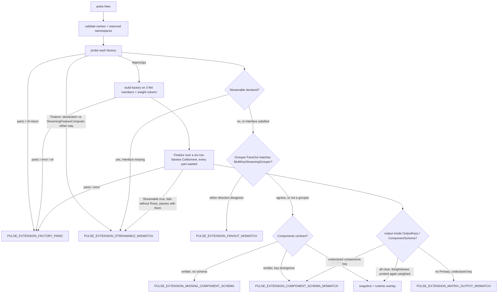

# Extension Points

**Audience:** Pulse embedders writing Go code that calls
`pulse.New(pulse.Options{Extensions: ...})` to inject domain-specific
operators or expression-runtime extensions. If you are adding a new
built-in operator to Pulse itself, see [Adding an
Aggregator](adding-aggregator.md) (and its sibling recipes) instead.
To register your own regression model, follow [Adding a Regression
Model (Embedders)](adding-regression.md).

The extension surface is Go-native. There is no plugin loader, no `.so`
files, no hot reload. Registration happens once when the embedding
binary constructs its Pulse instance, and the registration set is fixed
for the lifetime of that instance — restart to change it. Registered
extensions are first-class participants in Predict / Inspect / Process
/ Compose / Manifest: the runtime treats them identically to built-ins,
the manifest advertises them, and the schema-bound MCP tools include
their names in per-category enums.

**You author operators against the public `extend` package** — the
interfaces (`extend.Aggregator`, `extend.Grouper`, …), the read-only
`extend.Record` / `extend.Rows` views and the per-category factory
types. The operator engine itself (`internal/processing/...`) is not
importable by embedders; `extend` imports only `encoding`, `types` and
`errors` (`TestExtendImportBoundary`,
`TestExtendImportBoundary_NoTransitiveEngine`), and no public root
signature names an engine type (`TestRootSurfaceNamesNoProcessing`).
Engine-only capabilities — `MetaWindow`, `ExtensionAware`, `KeyFor`
and the engine's merge hooks (`MergeOnline`, `MergeGrouperState`) —
are deliberately absent from `extend`
(`TestExtendOmitsEngineOnlyCapabilities`); merging is public through
`extend.MergeableAggregator` / `extend.MergeableGrouper` /
`extend.MergeableAttribute`, behind an explicit `Mergeable`
declaration.

The implementation lives in the repository root: `extensions.go`
(public registration types), `extensions_adapt.go` (the adapters that
lift each `extend` operator onto the engine at `pulse.New`),
`extensions_validate.go` (name + registration shape checks),
`extensions_probe.go` (factory probe and components parity),
`extensions_runtime.go` (built-in/extension fold into the runtime
registry), `extensions_snapshot.go` (descriptor-side read-only
projection), and `internal/processing/extensions.go` (the runtime
overlay the engine consults).

## The `extend` contract: `Record`, `Rows` and reuse

`extend.Record` exposes `Schema`, `IsNull`, `NumericValue`,
`Uint64Value`, `StringValue`, `SetMaskValue`, `DecimalValue`, `VectorValue` and
`Weight`; `extend.Rows` exposes `Len` and `At(i)`. Accessors never
return an error — every "no value" answer is a false second return. The
silent cases: `NumericValue` is false for a null, projected-out or
missing field AND for every `set_*` field (read those with
`SetMaskValue`) and every `vec_f32` / `vec_f64` field (read those with
`VectorValue`: the elements as `float64`, a fresh copy safe to keep,
NaN elements verbatim) — though a native vector's element member
`f[k]` (below) reads through `NumericValue`; a categorical field's
`NumericValue` is its dictionary INDEX; `date` is epoch days and
`datetime` epoch seconds; `NumericValue` on a `u64` above 2^53 is only
the float echo (2^53 and 2^53+1 read alike) — `Uint64Value` returns the
exact stored word on every decode path (streaming, buffered, parallel,
shard archive, point lookup, filter-to-file), up to `math.MaxUint64`,
and is `(0, false)` exactly when `NumericValue` is false; `decimal128`
needs `DecimalValue` for exactness.

**Reuse contract.** The engine decodes into reusable buffers, so a
`Record` or `Rows` is valid ONLY for the call that received it. Never
retain one (copy out values; `encoding.SetMask` and
`encoding.Decimal128` are plain values), never mutate anything reachable
from a `Record` including its `*encoding.Schema`. `Record` and `Rows`
are consumer-only: Pulse implements them, embedders call them, and
methods may be added in a minor release.

## Row weights: `WeightAware` and `Record.Weight()`

`AggregatorRegistration`, `AttributeRegistration` and
`TestRegistration` carry `WeightAware bool`, projected as the manifest
extension entry's `weight_aware` (omitted when false). A WeightAware
operator reads the row weight the engine resolved for its slot — slot
`weight` → request `weight` → `pulse.Options.DefaultWeight` — through
`extend.Record.Weight() (float64, bool)`:

- `ok == false` means no weight is in force on the slot (or the
  operator is not WeightAware — every other operator, and every
  filterer, grouper, window and feature, always sees `(0, false)`).
- Only a VALID weight is ever reported: finite and non-negative (zero
  included), and an integer under `kind: frequency`. A row whose weight
  is invalid never reaches a WeightAware aggregator or tier-1 row test —
  it is excluded and counted (`n_weight_invalid`, one
  `PULSE_WEIGHT_INVALID_ROWS` warning per weight column). A WeightAware
  attribute owes every row a value, so it still receives such a row,
  with `Weight()` reporting false.
- The factory sees the resolved weight on its spec (`spec.Weight.Spec()`
  gives `{field, kind}` with the kind spelled out); `nil` when no weight
  applies.
- The orchestrator stamps the weighted floor keys (`sum_weights`,
  `n_eff`, `n_weight_invalid`) on a weighted aggregator slot, exactly as
  for a built-in. The operator never emits them, and they are not
  declared in its `ComponentSchema`.

A registration that does NOT declare `WeightAware` is classed like the
built-ins: an aggregator is skipped under the instance default
(predict reports `skipped_not_weight_aware`, the slot runs unweighted)
and refused with `PULSE_EXTENSION_NOT_WEIGHT_AWARE` under an explicit
slot or request weight; an attribute or test is refused under ANY
weight in force, the instance default included (it may read the whole
population, like the built-in tests and reference attributes). Every
refusal is opted out of with `"weight": null` on the slot. Predict,
manifest and runtime read the same declaration, so they always agree.
A WeightAware extension test is applied, not refused — unlike a
built-in `TEST_*`, the registration has declared its weighted form.

```go
func (a *wsum) UpdateRow(rec extend.Record, field string) error {
	x, ok := rec.NumericValue(field)
	if !ok {
		return nil
	}
	w, weighted := rec.Weight()
	if !weighted {
		w = 1
	}
	a.sum += w * x
	return nil
}
```

Contract long form: `.claude/reference/weighting.md` (Extension
contract).

## When to register vs use a built-in

Use a **built-in** operator when the semantics already ship with Pulse,
or when an `ATTR_FORMULA` plus a custom `ExprFunction` covers the
behaviour. Use a **registered extension** when you need:

- An operator that encodes proprietary business logic that should not
  live in Pulse core (e.g. a domain-specific composite score).
- A closed-form function call from within `ATTR_FORMULA` /
  `FILTER_EXPRESSION` (e.g. `rank_familiarity(value, total_pop)`).
- A static keyed lookup table that drives multipliers or calibration
  factors (e.g. per-`(study, wave)` adjustment).
- Manifest + MCP visibility so LLM agents can discover and invoke your
  operators alongside Pulse built-ins.

## The `Extensions` struct

The full public surface is a single struct on `pulse.Options`:

```go
import "github.com/frankbardon/pulse"

ext := pulse.Extensions{
    Aggregators: []pulse.AggregatorRegistration{...},
    Attributes:  []pulse.AttributeRegistration{...},
    Filterers:   []pulse.FiltererRegistration{...},
    Groupers:    []pulse.GrouperRegistration{...},
    Windows:     []pulse.WindowRegistration{...},
    Features:    []pulse.FeatureRegistration{...},
    Tests:       []pulse.TestRegistration{...},
    MatrixOps:   []pulse.MatrixOpRegistration{...},

    ExprFunctions:    []pulse.ExprFunction{...},
    LookupTables:     map[string]pulse.LookupTable{...},
    ReferenceVectors: map[string]types.ReferenceVectorTable{...},
    Populations:      map[string]pulse.Population{...},

    Skills:   skillsFS,   // fs.FS of embedder skill files — see "Embedder skills"
    Examples: examplesFS, // fs.FS of embedder request examples — see "Embedder examples"
}

p, err := pulse.New(pulse.Options{
    FS:         myFs,
    Extensions: ext,
})
```

A zero-value `Extensions` is the no-op case — `pulse.New` behaves
exactly as the unmodified binary. All registrations are validated
together; the first failure short-circuits `pulse.New` with a typed
`CodedError`.

**Synthetic-data distributions are not an extension category in v1.**
`pulse synth` / `Pulse.Synth` draw only from the built-in kinds the
manifest lists under `synth_distributions`; there is no registration
slot, no `SYNTH_*` extension prefix and no `extensions.synth_distributions`
manifest key. (An earlier alpha carried an `Extensions.SynthDistributions`
slot that reserved a name but could never sample; it was removed in U34.
An authoring contract may arrive additively in a v1.x release.)

## Naming policy

Embedder registrations MUST use a three-segment namespaced form:

```
<CATEGORY>_<NAMESPACE>_<NAME>
```

The regex enforced by `extensions_validate.go` is:

```
^(AGG|ATTR|FILTER|GROUP|WIN|FEAT|TEST|MAT|REG)_[A-Z][A-Z0-9]+_[A-Z](?:[A-Z0-9_]*[A-Z0-9])?$
```

| Example | Category | Namespace | Name |
|---|---|---|---|
| `AGG_ACME_BRAND_SCORE` | aggregator | ACME | BRAND_SCORE |
| `ATTR_ACME_ADJUSTMENT` | attribute | ACME | ADJUSTMENT |
| `FILTER_ACME_GEO_FENCE` | filterer | ACME | GEO_FENCE |
| `TEST_FINANCE_VAR` | test | FINANCE | VAR |
| `MAT_ACME_SCATTER` | matrix | ACME | SCATTER |
| `REG_ACME_HILL` | regression | ACME | HILL |

Failure modes raised at registration time:

- Name fails the regex → `PULSE_EXTENSION_NAME_INVALID`.
- Namespace is one of the reserved values `BUILTIN`, `STANDARD`,
  `CORE`, `PULSE` → `PULSE_EXTENSION_NAME_RESERVED`.
- Name collides with a built-in (e.g. registering `AGG_COUNT`,
  `REG_OLS`, or `MAT_PARTIAL_CORRELATION`, a built-in that happens to
  fit the pattern) → `PULSE_EXTENSION_NAME_COLLISION`.
- The category prefix does not match the registration slot (a
  `MAT_*` name under `Aggregators`, a `REG_*` name anywhere but
  `Regressions`) → `PULSE_EXTENSION_NAME_INVALID`.
- The same name appears twice in one `pulse.New` call →
  `PULSE_EXTENSION_DUPLICATE`.
- An aggregator, attribute, filterer, grouper, window, feature or
  regression registration with a nil `Factory` → `PULSE_EXTENSION_PARAM_INVALID`,
  `details.reason` `missing_factory` (with `category`, `name`,
  `index`), refused before any probe runs. A matrix operator refuses a
  nil `Factory` the same way in its own pass (table below); a test
  refuses a missing `RowFactory` / `PostFactory` per tier.

Two embedders in the same process must use disjoint namespaces.

## Per-category registration shapes

The nine operator categories plus expression functions and lookup
tables cover everything `pulse.Options.Extensions` accepts. Field-input
introspection and component-schema emission attach to operator
registrations as additional optional fields — see the dedicated
sections below.

### Aggregator

```go
{
    Name:        "AGG_ACME_BRAND_SCORE",
    Description: "ACME brand composite (0-100).",
    Factory:     acme.NewBrandScoreAggregator,    // extend.AggregatorFactory
    Streamable:  true,                            // factory MUST return extend.OnlineAggregator
    Mergeable:   true,                            // factory MUST return extend.MergeableAggregator; needs Streamable
    MarginReducibility: types.MarginSummable,     // optional: fused crosstab cell; needs Mergeable
    Accepts:     []encoding.FieldType{encoding.FieldTypeF64},
    Params:      []pulse.ParamMeta{{Name: "weights", JSONType: "array"}},
    ComponentSchema: descriptor.ComponentSchema{ /* see below */ },
    ComponentsFunc:  func(instance extend.Aggregator) (map[string]any, error) { /* ... */ },
}
```

**Declared params are an allowlist.** A registration's `Params` list is
checked exactly like a built-in's manifest list: a request slot whose
`params` object carries a key the list does not name is refused
`PULSE_REQUEST_UNKNOWN_FIELD` — `details.path`
(`aggregations[0].params.wieghts`) and a nearest-key suggestion — by
predict and by every runtime arm, before the factory runs. A vector-input
aggregator also accepts the engine's `labels` / `expand`, a matrix
operator the engine's `missing` / `max_drop_share` / `fit`. A
registration that declares **no** params is not checked: its params
reach the factory untouched, and predict adds the advisory
`PULSE_ADVISORY_EXTENSION_PARAMS_UNDECLARED` (`details.slot`,
`operator`, `keys`) so the caller knows a misspelled key would pass.
Declare every key the factory reads.

**Declared values are typed and required-checked.** For a registration
that declares params, every declared value is also checked against its
`ParamMeta`, in all nine categories and before any operator code runs:
a value whose JSON type is not the declared `JSONType` (a JSON `null`
included), or a `Required` param the slot omits (an absent `params`
object included), is refused `PULSE_REQUEST_PARAM_INVALID` —
`details.path` (`aggregations[0].params.scale`), `details.reason`
(`wrong_type`, with `expected` / `got`, or `missing_required`),
`operator`, `param` — identically by predict and every runtime arm.
So is a params object carrying none, or more than one, of the members
of an `ExactlyOneOf` group (`details.reason` `exactly_one_of`,
`details.path` `aggregations[0].params`, `group`, `members`, and the
members `present`). The faults are checked in order — an unknown key
first, then a wrong type, then a missing `Required` param, then an
`ExactlyOneOf` group — and the first one found is the refusal.
`Default` is never filled in: the factory still applies it, exactly as
on a request that omits the param. A JSON
`number` covers integers and decimals alike; a factory that needs an
integer still checks that itself. Because a request can now only reach
the factory with every `Required` param present and exactly one member
of each `ExactlyOneOf` group, the `pulse.New` probe
hands the factory a params object that satisfies the same declaration
— see [Probe validation](#probe-validation-full-surface) — so a factory
may refuse an absent `Required` param itself.

**One-of-several params.** When the factory takes exactly one of
several params (an EWMA's `span` or `halflife`), tag each with the same
`ParamMeta.ExactlyOneOf` group name. The manifest shows it as
`exactly_one_of`, and Recommend drafts the group's first member as a
need, naming the others as alternatives. A group needs two or more
members, none `Required` and none with a `Default`; anything else is
`PULSE_EXTENSION_PARAM_INVALID`. A request naming none or several of a
group's members is refused before the factory runs (above), so the
factory sees exactly one.

**Example values.** `ParamMeta.Example` (optional, any JSON value) is an
example of the param's value. `pulse.New` checks it with the same value
checker a request's params go through: it must marshal to a JSON value
of the declared `JSONType`, else `PULSE_EXTENSION_PARAM_INVALID`
(`details.reason` `example_type_mismatch`, `expected` / `got`, `got`
`unmarshalable` when it does not marshal). The manifest shows it as
`example` on the param row (`extensions.<category>[].params[]`, and in
the built-in `Param` shape of an extension `MAT_*` / `REG_*`). On a
`Required` param or the first member of an `ExactlyOneOf` group, the
registration probe hands the factory the `Example` instead of the
generic placeholder (see [Probe validation](#probe-validation-full-surface)),
so a factory that accepts only certain values — an enum-like string —
declares one it accepts. On any other param it is documentation only.

When `Streamable=true`, the probe at `pulse.New` time asserts that the
factory's returned value implements `extend.OnlineAggregator`.
Mismatch surfaces as `PULSE_EXTENSION_STREAMABLE_MISMATCH`. The
declaration is authoritative at run time: a `Streamable=false`
aggregator runs buffered even when its value also implements
`extend.OnlineAggregator`, so `PredictResult.Streamable` (which reads
the declaration) and the engine never disagree.

Aggregators are authored against the public `extend` package:
`Aggregate(rows extend.Rows, field)` receives a zero-copy view of the
buffered rows, `UpdateRow(rec extend.Record, field)` one row at a time.
A `Record` / `Rows` is valid only for the call that received it — never
retain one. The adapter installed at `pulse.New` forwards each optional
sibling (`extend.OnlineAggregator`, `extend.RichAggregator`,
`extend.MergeableAggregator`) explicitly, so a streamable aggregator
that also supplies `ComponentsFunc` still streams and merges. Read semantics (null, set, categorical, date/datetime, u64,
decimal128) are on each `extend.Record` method's godoc.

**Decimal128 targets.** The built-in decimal table (exact `AGG_SUM`,
`AGG_AVERAGE`, … — see `skills/financial-cohorts.md`) governs built-ins
only: a built-in outside it is refused on a `decimal128` field
(`PULSE_AGG_NOT_MEANINGFUL_FOR_DECIMAL`, predict and run time alike — the
accepted-types table's decimal rule, see below). A registered extension
aggregator is never refused — its
factory runs and the extension decides what a decimal field means, reading
the exact value through `extend.Record.DecimalValue` (`NumericValue` is a
rounded echo) and typically rendering it via `extend.RichAggregator`.
Path selection follows the declaration, not the field type: a built-in
over a decimal target always runs buffered (the exact
`AggregateDecimalField` path), but an extension aggregator declaring
`Streamable: true` streams it — **`UpdateRow` sees decimal fields via
`DecimalValue`**, exactly as the buffered `Aggregate` does — and
predict reports the same (`Streamable` from the snapshot, no decimal
reason). The built-in decimal merge refusal does not apply either: a
`Mergeable` extension aggregator merges a decimal target under shard /
decode parallelism like any other field.

**Mergeable.** `Mergeable: true` admits the aggregator to the parallel
reducers — `Options.ShardWorkers` over a shard archive and
`Options.DecodeWorkers` over a large single-file cohort — and to
`ProcessChain` stages. Each worker folds its partition through
`UpdateRow` on a fresh instance; the orchestrator then combines the
partials in a deterministic order with
`extend.MergeableAggregator.Merge(other)` and calls `Finalize`,
`Rich` and `ComponentsFunc` once, on the merged receiver. `other` is
the embedder's own value built by the same factory from the same spec,
so `other.(*myAgg)` succeeds. Merge must be associative; how the
cohort is partitioned depends on the worker count, so an extension's
floating-point `+=` fold may differ from the serial answer in the last
ULP. (The built-in float sums do not: `AGG_SUM`, `AGG_AVERAGE`,
`AGG_RATIO`, the weighted sums, the `sum_weights` floor and `total()`
accumulate in a binned reproducible sum, bit-identical under every
worker count and shard split; the Welford moments stay within ULP. The
kernel is internal — an extension that needs the same guarantee keeps
an order-free state, such as exact integers or per-block partials
merged in a fixed order.) The
declaration, not the method set, routes the request: an aggregator
that implements `Merge` but omits `Mergeable` runs serially (and a
chain refuses it). Probe-validation refuses `Mergeable` with
`PULSE_EXTENSION_MERGEABLE_MISMATCH` when the registration is not also
`Streamable` (merge folds online state), when the value does not
implement `extend.MergeableAggregator`, or when `ComponentSchema`
declares keys with `Mergeability: None` — the reducers read
`Components()` off the MERGED instance, so a figure that needs the full
input would be silently wrong. The manifest projects the flag as
`extensions.aggregators[].mergeable`.

**MarginReducibility (fused crosstab cells).** A crosstab whose cell is
an extension aggregator takes the fused in-decode arm
(`processing.CanFuseCrosstab`) only when the registration declares a
margin class — the embedder-side sibling of
`types.AggregationType.MarginReducibility()`: `types.MarginSummable`
(the margin is the sum of the cells), `types.MarginMeanReducible`
(derivable from per-cell value + count) or `types.MarginIndependent`
(set-valued state whose margin is neither a sum nor a re-scan). Any of
the three admits the cell; omitted or `types.MarginRecompute` keeps the
crosstab on the buffered arm, which is what every undeclared extension
cell did before. The class gates ADMISSION only: the fused walk gives
every row, column, grand and cross-axis margin its own instance fed
record by record through `UpdateRow`, exactly as it does for a built-in,
so the class never changes a margin figure — an honest class is still
required, because the manifest and predict read it. A fusable class
requires `Mergeable: true` (and so `Streamable: true`) — the fused gate
holds an extension cell to the built-in cell's mergeable bar — and the
usual fused-gate conditions apply (a `FieldInputs` hook, keyable
groupers, no tests / features / two-pass attributes). Like the decimal
rule above, a decimal128 extension cell fuses on its declaration while a
built-in decimal cell stays buffered. Probe-validation refuses an
unknown class, or a fusable class without `Mergeable`, with
`PULSE_EXTENSION_MARGIN_REDUCIBILITY_MISMATCH`. An extension used as a
`margin_aggregations` AUXILIARY needs no class — an auxiliary is
independent in role — only `Mergeable`. The manifest projects the class
as `extensions.aggregators[].margin_reducibility`, and predict's
`PULSE_CROSSTAB_NORMALIZE_UNSATISFIABLE` advisory reads it from the
snapshot.

### Attribute

```go
{
    Name:        "ATTR_ACME_ADJUSTMENT",
    Description: "Per-(study, wave) multiplier.",
    Factory:     newAdjustmentAttribute,           // extend.AttributeFactory
    Mode:        pulse.AttributeModeRowLocal,       // row_local | two_pass | buffered
    Accepts:     []encoding.FieldType{encoding.FieldTypeF64},
    Emits:       pulse.AttributeEmitFloat64,
}
```

`Mode` drives streaming-tier validation: `row_local` requires
`extend.RowLocalAttribute` (`Row(rec extend.Record, field)`),
`two_pass` requires `extend.TwoPassAttribute` (adds `PrePass` +
`Finalize`), `buffered` requires only the base
`extend.AttributeComputer` (`Compute(rows extend.Rows, field)
([]float64, error)`, one value per row, aligned with `rows`). The probe
asserts the `extend` sibling on the factory's own value; the adapter
forwards exactly the tier it implements. To give a row no value, an
attribute of any `Mode` implements the optional
`extend.NullableAttribute` (`EmitsNull() bool`, answered per
instance) and returns `NaN` for that row from `Compute` or `Row`: when
`EmitsNull` reports true, every arm (streaming, two-pass, buffered,
both crosstab arms, parallel decode, shard archive) writes the `NaN` as
a null under the label, exactly like a built-in score of a null input
— the row reads `null` in `Data`, a downstream aggregation skips it
and counts it in `n_null`, a grouper buckets it nowhere. Without the
interface, or when it reports false, a `NaN` stays an ordinary value
(the aggregation folds it), byte-identically to before. Follow the
built-ins' null-in, null-out rule: a null source cell scores null, not
`0`. An attribute MAY declare a
`ComponentSchema` + `ComponentsFunc` (`pulse.AttributeComponentsFunc`,
called once after the attribute scored every filter-passing row): its
slot then carries one `Response.Components.Attributes` entry — the
attribute floor `{n, n_null}` (rows whose output is present / null,
filled by the orchestrator) plus the emitter's keys as `operator`. With
no `ComponentsFunc`, a value's own `Components()` method is adopted as
the emitter, exactly as for the other categories.

**Mergeable attributes.** A component-emitting attribute keeps a
per-run tally, which one instance per worker would split. By default
such an attribute is therefore never admitted to the parallel reducers
or `ProcessChain`, whatever its `Mode`, and a request carrying it runs
serially. A `row_local` attribute can opt in, exactly as the built-in
`ATTR_SCALE_SCORE` and reference-form `ATTR_PROFILE_SIMILARITY` do:
declare `Mergeable: true` and return a value implementing
`extend.MergeableAttribute`:

```go
// MergeTally folds another partition's tally into the receiver; other
// is the embedder's own value from the same factory and spec.
func (a *highAttr) MergeTally(other extend.RowLocalAttribute) error {
    a.high += other.(*highAttr).high
    return nil
}
```

The parallel reducers (`ShardWorkers`, `DecodeWorkers`) then score
each partition on a fresh instance, fold the partitions through
`MergeTally` and read the emitter once, off the merged instance, so the
entry equals the serial run's; the same declaration admits the
attribute to `ProcessChain` stages. Keep the tally associative —
integer counts are exact in any order. Probe-validation refuses
`Mergeable` with `PULSE_EXTENSION_MERGEABLE_MISMATCH` when the `Mode`
is not `row_local` (`mergeable_without_row_local`), when the value
emits components without implementing `extend.MergeableAttribute`
(`missing_merge_interface`), or when the `ComponentSchema` is
classified `None` (`components_not_mergeable`). A `row_local`
attribute that emits nothing merges either way and needs no method.
The flag reaches the manifest as `extensions.attributes[].mergeable`.
`Mode` also picks the run-time drive on `Process`: `row_local` streams
through `Row`, `two_pass` takes the streaming `PrePass` → `Finalize` →
`Row` drive, `buffered` runs `Compute` over the materialised rows. Like
the built-in two-pass attributes (`ATTR_ZSCORE`, …), a `two_pass`
extension runs buffered when the request also carries a grouper,
feature, regression or tier-1 test.
On the streaming drive every attribute runs in declared order, so a
`two_pass` attribute can read an earlier attribute's label: the engine
learns which earlier labels it reads from `Field` plus its
`FieldInputs` hook. Without the hook it assumes the attribute reads
every earlier attribute — still correct, but each earlier `two_pass`
attribute then costs an extra scan.

### Filterer, Grouper, Window, Feature

All four follow the same envelope: name, description, factory, accepted
types, params metadata. `FiltererRegistration` and `GrouperRegistration`
additionally carry `ComponentSchema` + `ComponentsFunc` on the same
contract as `AggregatorRegistration`. Filterers are always row-local
streamable; windows always run buffered.

`GrouperRegistration` additionally carries `FansOut bool` — the
embedder-side sibling of `types.GroupType.FansOut()`, which knows
built-in constants only. Set it `true` when the factory returns a
value that also implements `extend.MultiKeyStreamingGrouper`
(`KeysForRow`), i.e. when one record can land in more than one bucket.
Consumers that reason about per-record denominators need the fact:
under a fan-out grouper the bucket counts SUM to more than the record
total, so an `n` taken from a slab total double-counts records. The
probe verifies the claim in BOTH directions
(`PULSE_EXTENSION_FANOUT_MISMATCH`), and omitting the field defaults it
to `false` — so a multi-key factory is refused rather than silently
admitted as single-key.

A registered grouper is also a `MAT_DISTANCE` `params.between`, judged
like a built-in (its `vector` / `fields` by the member rules and handed
to the factory as literal `Fields`; a `field` must name a schema column;
no own `weight` or `tz`). No extra hook is needed: the engine buckets
the rows with your buffered `Group` in one whole-set pass at finalize,
so the spec is buffered and serial whatever `Streamable` declares, its
bucket keys alphabetical (or the `include` order). Projection reads the
`FieldInputs` hook exactly as for a `groups` slot.

Groupers and filterers are authored against `extend` too. A grouper's
buffered `Group(rows extend.Rows, field)` returns
`map[string][]int` — row INDICES into `rows`, which the adapter maps
back to the engine's records (an out-of-range index is a
`PROCESSING_INTERNAL` coded error, never a panic). The streaming
siblings are `extend.StreamingGrouper` (`KeyForRow`) and
`extend.MultiKeyStreamingGrouper` (`KeysForRow`); returning
`extend.ErrGrouperKeyNull` from either is the same as `ok=false` — the
row lands in no bucket. A filterer is an `extend.FiltererFactory`
returning an `extend.FiltererBuilder` whose `Build` compiles an
`extend.FilterFunc func(extend.Record) (bool, error)`. A registered
filterer runs on every entry point a built-in filterer does —
`FilterToFileWithRequest`'s structured `Filterers` included, where it
is built through the same registry `Process` uses and keeps the same
rows (it is never translated into an expression; like every extension
operator it is not zone-capable, so a `tz` / `tz_field` on it is
refused there exactly as `Process` refuses it). The adapter
forwards each keying sibling explicitly, so a fan-out grouper that also
supplies `ComponentsFunc` stays multi-key (and fuses in a crosstab).
A single-key `extend.StreamingGrouper` fuses too: the adapter binds the
`types.Group.Field` the factory was built for and synthesizes the
engine-only field-bound `KeyFor` from your `KeyForRow`, so your method
always receives the real field name. The fused gate reads the
DECLARATION: a crosstab axis grouper fuses iff its registration
declares `Streamable=true` or `FansOut=true` (both probe-validated, so
the keying sibling is guaranteed). This is a deliberate change — the
gate used to probe the constructed value's interface, so a
`Streamable=false` grouper implementing `KeyForRow` fused; it now runs
the buffered crosstab arm, with identical output and only peak heap
differing, because `pulse predict` (`PredictResult.CrosstabFusable`)
can read only the declaration and both sides run one rule. Declare
`Streamable=true` to keep such a grouper on the fused arm.
`Streamable=true` routes the grouped `Process` request onto the
streaming path, driving `KeyForRow` / `KeysForRow` per row; the probe
refuses a `Streamable=true` registration whose value implements
neither keying sibling (`PULSE_EXTENSION_STREAMABLE_MISMATCH`). A
`Streamable=false` grouper runs buffered through `Group` even when it
can key per row.

**Mergeable groupers.** `Mergeable: true` (with `Streamable: true`)
admits the grouper — single-key or fan-out — to the parallel reducers
(`ShardWorkers`, `DecodeWorkers`) and to ProcessChain stages. Each
partition gets its own instance keyed through `KeyForRow` /
`KeysForRow`; the engine merges the per-key aggregator buckets and
sums the (record, bucket) assignment count behind the
`{total_n, n_null}` floor itself. What it cannot merge is your
components state, so a grouper that EMITS components (`ComponentsFunc`,
or its own `Components()` method) must implement
`extend.MergeableGrouper.MergeState(other)`: fold `other`'s counters
into the receiver — `other` is your own value from the same factory
and spec — and `ComponentsFunc` then runs once, on the merged receiver.
A grouper that emits no components needs no method; the adapter folds
nothing. Probe-validation refuses `Mergeable` without `Streamable`, an
emitting value without `MergeState`, and `ComponentSchema` keys
classified `None` (`PULSE_EXTENSION_MERGEABLE_MISMATCH`). The flag
reaches the manifest as `extensions.groupers[].mergeable`. Omitted,
grouped requests naming the grouper run serially and a chain refuses
it.

A window is an `extend.WindowFactory` taking the spec and an empty
`extend.WindowOptions` and returning an `extend.WindowComputer`
(`Compute(rows []map[string]any, partitions [][]int, label string)`);
it writes its column into the materialised result rows in place.

A feature is an `extend.FeatureFactory` returning an
`extend.FeatureComputer`: `Compute(rows extend.Rows, field)` returns
`map[string]extend.FeatureOutput` keyed by output column, each
`{Values, Nulls}` aligned with `rows`. The optional streaming sibling
`extend.StreamingFeatureComputer` (`PrePass`, `Finalize`, `EmitRow`)
returns single-row outputs from `EmitRow`; any other shape is a
`PROCESSING_INTERNAL` coded error. Features only READ rows — the engine
writes the derived columns. Feature streamability is decided on the
returned value (the adapter exposes the streaming sibling iff the
embedder's value implements it), so a streaming extension feature does
stream on `Process` — while predict reads the declared `Streamable`.
`pulse.New` therefore probes each feature factory once (empty schema,
a spec carrying only the `Name`) and refuses a declaration that
disagrees with the value IN EITHER DIRECTION with
`PULSE_EXTENSION_STREAMABLE_MISMATCH` (details `category: "feature"`,
`streamable` = the declaration): `Streamable: true` needs a value
implementing `extend.StreamingFeatureComputer`, and `Streamable: false`
needs one that does not. A factory that panics, errors or returns nil
under the probe is `PULSE_EXTENSION_FACTORY_PANIC`.

### Test (tier-1 / tier-2)

```go
// Tier-1 (folds during streaming aggregation pass):
{
    Name:       "TEST_ACME_PROXY",
    Tier:       pulse.TestTierRow,
    RowFactory: newProxyRowTest,                  // extend.RowTestFactory
    Streamable: true,
}

// Tier-2 (runs over materialised result rows after windows):
{
    Name:        "TEST_ACME_AGGREGATE_CHECK",
    Tier:        pulse.TestTierPost,
    PostFactory: newAggregateCheckPostTest,       // extend.PostTestFactory
}
```

Exactly one of `RowFactory` / `PostFactory` must be non-nil and match
`Tier`. A tier-1 `extend.RowTest` folds `UpdateRow(rec extend.Record)`
then `Finalize() (*types.TestResult, error)`; a tier-2 `extend.PostTest`
runs `Run(rows []map[string]any)` once over the result rows. Tier-2
tests always run buffered; `Streamable` on a tier-2 registration is
ignored. A tier-1 test declared `Streamable=true` co-streams with
online aggregators (`UpdateRow` folds during the single pass);
`Streamable=false` forces the request buffered.

An extension `TEST_*` joins multiple-comparison families exactly like a
built-in: its headline `PValue` is one member of the `request` (or
`compose`) family under the resolved `multiplicity` block, and the fold
adds `p_adjusted`, `significant_adjusted` and `multiplicity` to its
`TestResult`. The registration declares nothing for it.

### Matrix operator (`MatrixOps`)

A `MAT_<NS>_<NAME>` operator computes one matrix result from a
`Request.Matrices` slot. It is **finalize-only**: the engine folds the
member columns into per-block `linalg.CoMoment` state, merges the 4096-row
blocks through its fixed merge tree, and calls `Finalize` once per
result (once per group bucket) with the merged co-moment. The operator
never folds rows, so a pure `Finalize` is bit-identical under every
`DecodeWorkers` / `ShardWorkers` count and shard split. The engine's
block merge is not part of `extend`.

```go
type scatter struct{}

func (scatter) Finalize(in *extend.MatrixInput) (extend.MatrixOutput, error) {
    cm := in.CoMoment // read-only: never Add or Merge
    out := extend.MatrixOutput{Primary: in.Square(cm.PairM2)}
    if in.WantScalars {
        tr := 0.0
        for i := 0; i < cm.P(); i++ {
            tr += cm.PairM2(i, i)
        }
        out.Scalars = map[string]float64{"trace": tr}
    }
    return out, nil
}

reg := pulse.MatrixOpRegistration{
    Name:        "MAT_ACME_SCATTER",
    Description: "Scatter matrix: each pair's raw weighted co-moment.",
    Factory: func(*types.MatrixSpec, *encoding.Schema) (extend.MatrixOperator, error) {
        return scatter{}, nil
    },
    Streamable: true,
    OutputKeys: descriptor.MatrixOutputKeys{Primary: "scatter", Scalars: []string{"trace"}},
}
```

`extend.MatrixInput` carries the read-only `*linalg.CoMoment` (read it
through `Cov`, `Corr`, `Mean`, the counts and weight sums, and the raw
per-pair co-moment `PairM2`), the members in axis order, their explicit
labels, the raw `params`, the folded weight's kind (`""` when
unweighted), the requested encoding, and the `WantAuxiliary` /
`WantVectors` / `WantScalars` flags a `return` exclusion clears.
`Square` and `Rect` render a matrix in that encoding. A registration
declaring `Streamable: false` also receives the admitted rows
(`MatrixRows`) and runs buffered and serially. `extend.MatrixOutput`
holds the primary (required), auxiliary matrices, vectors, scalars,
warnings and the operator's own components keys.

Validation at `pulse.New`, beyond the naming policy and the
`ParamMeta` rules:

| Rule | Code | `details.reason` |
|---|---|---|
| `Factory` is nil | `PULSE_EXTENSION_PARAM_INVALID` | `missing_factory` |
| `OutputKeys.Primary` is empty | `PULSE_EXTENSION_PARAM_INVALID` | `missing_output_keys` |
| an `Auxiliary` / `Vectors` / `Scalars` key is empty or listed twice | `PULSE_EXTENSION_PARAM_INVALID` | `invalid_output_key` |
| `ComponentSchema.Mergeability` without `Keys` | `PULSE_EXTENSION_MISSING_COMPONENT_SCHEMA` | `mergeability_without_keys` |
| `ComponentSchema.Keys` without `Mergeability` | `PULSE_EXTENSION_PARAM_INVALID` | `missing_mergeability` |
| a components key is empty or listed twice | `PULSE_EXTENSION_PARAM_INVALID` | `invalid_component_key` |
| a components key restates the matrix floor (`n`, `n_null`, `n_listwise_dropped`, `min_pair_n`, `max_pair_n`) or the weighted floor (`sum_weights`, `n_eff`, `n_weight_invalid`) | `PULSE_EXTENSION_PARAM_INVALID` | `reserved_component_key` |

A matrix registration has no `ComponentsFunc`: its components ride
`MatrixOutput.Components`, after the engine's floor.

The probe at `pulse.New` is the one that feeds data: it builds the
factory against a synthetic schema of three `f64` members (plus a
weight column) with a spec naming them, and runs `Finalize` over a
small well-conditioned listwise co-moment of six rows with every part
wanted — rows attached only on the `Streamable: false` tier. A
`WeightAware` registration is probed a second time with a weight on the
spec, a weighted co-moment and `WeightKind` `probability` (a failure
there carries `details.weighted: true`); any other is probed
unweighted only. `Finalize` must be pure and succeed on that input.

| Probe failure | Code | `details` |
|---|---|---|
| factory panics, errors or returns nil | `PULSE_EXTENSION_FACTORY_PANIC` | `stage: factory` |
| `Finalize` panics or errors | `PULSE_EXTENSION_FACTORY_PANIC` | `stage: finalize` |
| `Streamable: true` but `Finalize` fails without `Rows` and succeeds with them | `PULSE_EXTENSION_STREAMABLE_MISMATCH` | `reason: reads_rows` |
| no `Primary` | `PULSE_EXTENSION_MATRIX_OUTPUT_MISMATCH` | `reason: missing_primary` |
| an `Auxiliary` / `Vectors` / `Scalars` key `OutputKeys` does not declare (a declared key left unfilled is fine) | `PULSE_EXTENSION_MATRIX_OUTPUT_MISMATCH` | `reason: undeclared_output_key`, `part`, `undeclared`, `declared_keys` |
| a `Components` key `ComponentSchema` does not declare (a floor key included) | `PULSE_EXTENSION_COMPONENT_SCHEMA_MISMATCH` | `reason: components_schema_mismatch` |

Two more registration rules bind the engine-owned surface:

| Rule | Code | `details.reason` |
|---|---|---|
| a `Params` entry named `missing`, `max_drop_share` or `fit` (the engine owns them) | `PULSE_EXTENSION_PARAM_INVALID` | `reserved_matrix_param` |
| `PValues` names no `OutputKeys.Auxiliary` key | `PULSE_EXTENSION_PARAM_INVALID` | `invalid_pvalues` |
| `OutputKeys.Auxiliary` declares `<PValues>_adjusted` or `significant_adjusted` | `PULSE_EXTENSION_PARAM_INVALID` | `reserved_output_key` |

**At run time** the operator is a built-in in every respect but its
finalizer:

- **Resolution.** A spec naming it resolves like a built-in one (shape,
  encoding, result name, members by the vector rules) with the
  registration's `Accepts` narrowing the member column types
  (`PULSE_VECTOR_MEMBER_TYPE`; empty = the built-in member types, an
  element of a native vector reading as `f32` / `f64`). The engine
  decodes `params.missing`, `params.max_drop_share` and `params.fit`
  exactly as for a built-in (listwise / pairwise, the heavy-drop warning;
  under `fit` the slot folds no row and `Finalize` gets the bound vector
  fit's co-moment, its weight basis as `WeightKind`) and STRIPS them:
  the factory's spec and `MatrixInput.Params` carry only the operator's
  own keys. A params value that is not a JSON object is
  `SERVICE_VALIDATION` `bad_params`; a factory error that is not a
  `*errors.CodedError` becomes `SERVICE_VALIDATION` `bad_params`.
- **Tier.** `Streamable: true` streams and merges across
  `DecodeWorkers` / `ShardWorkers` through the blocked merge;
  `Streamable: false` keeps the admitted rows, so the request runs
  buffered and serially. Predict reports the same `streamable` /
  `mergeable` and sizes the row buffer.
- **Finalize.** Built once per request (every group bucket shares the
  instance), called once per result with a per-call CLONE of the merged
  co-moment, so even an operator that mutates it reaches neither the
  components floor nor another bucket. The engine's data-quality
  warnings (thin rows, zero spread, listwise heavy drop) lead the
  operator's own. The output is held to `OutputKeys` / `ComponentSchema`
  on every run, not only at the probe (same codes as the probe table).
  On a run that keeps `components.matrices` but excludes the `matrices`
  slot, an operator declaring component keys is still finalized, every
  `Want*` false.
- **Weights.** A `WeightAware` operator's slot is stamped with the
  resolved weight (`MatrixInput.WeightKind`); one that is not is refused
  under ANY weight in force — slot, request or instance default — with
  `PULSE_EXTENSION_NOT_WEIGHT_AWARE` (`weight: null` opts out).
- **Multiplicity.** Opt-in: `PValues` names the auxiliary key of the
  per-cell p-value matrix (off-diagonal upper triangle of a square one).
  A `multiplicity` block — the spec's, the request's or
  `Options.DefaultMultiplicity` — adjusts them like a built-in
  inferential matrix: `<PValues>_adjusted` and `significant_adjusted`
  beside the raw matrix (with `PValues: "p"` exactly the built-ins'
  `p_adjusted`), the `multiplicity` echo, and predict's `p_values`. An
  operator without `PValues` refuses a spec-level block
  (`PULSE_MULTIPLICITY_INVALID`).
- **Bits.** The bit contract holds through public registration alone:
  `TestExtensionMatrix_WorkerInvariant` registers an operator rendering
  every raw co-moment figure and requires the same bits serially, under
  `DecodeWorkers` 2/3/7/8 over a file above the parallel-decode
  threshold, and under `ShardWorkers` 1/2/3/8 over an uneven shard
  archive against its single-file twin — listwise and pairwise,
  weighted and unweighted, grouped and ungrouped — each parallel run on
  its parallel arm; the `Streamable: false` tier runs serially under
  every knob and lands on the same bits. Keep `Finalize` pure (no
  clocks, no randomness, no state carried between calls) and the
  guarantee is yours.
- **Hosts.** The matrix host refusals hold unchanged: a join, a
  crosstab and a chain stage after 0 refuse it as they refuse a built-in.
- **Self-description.** The manifest lists it under
  `extensions.matrix_ops` in the built-in `matrices` shape (the
  engine-owned params first, the matrix floor plus the weighted floor
  when `WeightAware`, then its own component keys) and under
  `components_schemas.matrices`; the instance payload schema's
  `MatrixType` enum (as every category's extensions join theirs), the
  MCP `type` enum, the ontology (a node requiring
  `capability:matrices`) and the recommend binder carry it. A feature
  profile that omits it hides it everywhere; listing it needs
  `capability:matrices`.

### Regression model (`Regressions`)

> Step-by-step recipe with a streaming and a buffered example:
> [Adding a Regression Model (Embedders)](adding-regression.md).

`Extensions.Regressions []pulse.RegressionRegistration` registers
`REG_<NAMESPACE>_<NAME>` models for `Request.Regressions`, authored
against `extend.Regression`. The factory (`extend.RegressionFactory`,
built per slot from the spec and schema) returns one of two forms,
matching the registration's `Streamable` declaration:

- **Streaming** (`Streamable: true`) — `extend.StreamingRegression`:
  `UpdateRow(rec)`, `Merge(other)` (required; regressions run serially
  today, so the engine does not call it yet) and `Finalize()`. It
  streams wherever a built-in regression would (no grouper, feature or
  two-pass attribute; no `resample`, `selection` or robust
  `covariance`); otherwise the engine feeds it the buffered rows through
  `UpdateRow`, in record order — never `Fit`.
- **Buffered** (`Streamable: false`) — `extend.BufferedRegression`:
  `Fit(rows)` over every admitted row, free to iterate.

The engine admits rows (listwise on `target` and every predictor; on a
weighted `WeightAware` slot, only rows whose weight is valid and
positive, each reporting it through `Record.Weight()`) and the model
returns a narrow `extend.RegressionOutput`: `Coefficients` (each a
`Name`, an `Estimate` and optional `StdErr` / `Statistic` / `PValue` —
nil is absent, `null` on the wire with the key kept; `extend.Figure(v)`
builds one), optional `Fit` statistics from the fixed set (`R2`,
`AdjR2`, `ResidualStdErr`, `DF`, `Deviance`, `NullDeviance`,
`PseudoR2`, `Iterations`), a `Vcov` (square over the coefficients, in
their order) and `Outputs`. The adapter maps it onto
`types.RegressionResult` and owns the rest: name and type, `n_obs`,
`sum_weights` / `n_eff`, the confidence intervals (see **Intervals**),
the multiplicity fold (a `PValues` model's
coefficients with a defined p-value join a default family; an explicit
`multiplicity.coefficients` list names the model's own coefficients)
and per-slot failure (a model error coded
`PROCESSING_REGRESSION_INSUFFICIENT_DATA`, `_RANK_DEFICIENT`,
`_NO_CONVERGE` or `_SEPARATION` fails its slot alone; any other is
fatal; a panic is `PROCESSING_PANIC`).

| Registration field | Meaning |
|---|---|
| `Streamable` | the form; decides the path at runtime and in predict |
| `WeightAware` | the model reads row weights; undeclared, any weight in force is `PULSE_EXTENSION_NOT_WEIGHT_AWARE` |
| `Vcov` | `vcov: true` is honoured (result `vcov` + `correlation`); undeclared it is `PROCESSING_CONFIG` `{regression, slot: "vcov"}` at predict and runtime |
| `PValues` | the model emits coefficient p-values, so its slot takes a `multiplicity` block (family: the coefficients with a defined p, the intercept excluded) and predict counts them. Undeclared, the model emits none: `p_values` is null on every coefficient (under `resample` too), predict counts none, a block resolving to any method but `none` is `PULSE_MULTIPLICITY_INVALID` (`key: "method"`, `valid: ["none"]`) at predict and runtime alike, and a fit reporting a finite p-value is `PULSE_EXTENSION_REGRESSION_OUTPUT_MISMATCH` reason `undeclared_p_value` (at `pulse.New` on the probe fit, and on every run) |
| `Penalty` | the model reads the shared `penalty` / `alpha` / `l1_ratio` slots itself (their values are the model's to judge); undeclared, any of them is `PROCESSING_CONFIG` `{regression, slot: "penalty"}` (`key` names a companion) |
| `SupportsSelection` | the model can be refit over a predictor subset, so the engine's selection driver (`forward` / `backward` / `stepwise`) may wrap it; each candidate fit must report `Fit.Deviance` (−2·log-likelihood up to a constant every candidate shares), scored AIC = deviance + 2k or BIC = deviance + ln(n)·k with k its coefficient count and n its `n_obs` — a fit without one is `PULSE_EXTENSION_REGRESSION_OUTPUT_MISMATCH` reason `missing_deviance` (at `pulse.New` on the probe fit, and on any candidate). Undeclared, `selection` / `criterion` are `PROCESSING_CONFIG` `{regression, slot: "selection"}` at predict and runtime |
| `CovarianceTypes` | `[]types.CovarianceType` the model computes itself from `spec.Covariance`: a block whose type (absent = `classical`) is listed reaches the model after the shared shape rule (`cluster` needs `cluster`, `hac` needs `order_by`; a robust type beside `penalty` is `PROCESSING_REGRESSION_VCOV_UNSUPPORTED`); any other type is `PROCESSING_CONFIG` `{regression, slot: "covariance"}`. An unknown or repeated entry fails `pulse.New` (`PULSE_EXTENSION_PARAM_INVALID`, reason `invalid_covariance_type`). A robust type forces the buffered path |
| `Params` | `[]pulse.ParamMeta` — the keys of the slot's own `params` object (`RegressionSpec.Params`, which the factory reads off the spec); declared, any other key is `PULSE_REQUEST_UNKNOWN_FIELD` at `regressions[i].params.<key>`, and a wrong-typed value, a missing `Required` param or not exactly one member of an `ExactlyOneOf` group is `PULSE_REQUEST_PARAM_INVALID`, at predict and runtime alike; undeclared, params pass through (predict advises `PULSE_ADVISORY_EXTENSION_PARAMS_UNDECLARED`). A built-in `REG_*` declares none, so any `params` key on one is refused |
| `OutputSchema` | `[]pulse.RegressionOutputMeta{Key, JSONType, Description}` — the `Outputs` keys the model may fill (`invalid_output_key` on an empty, repeated or untyped key). `Outputs` survives `disable_components` and every `return` preset |
| `Accepts` | `[]encoding.FieldType` the target and predictors accept; empty means the built-in regressions' set (analytics-numeric). Any other field type is `PULSE_FIELD_TYPE_UNSUPPORTED` at predict and runtime alike (the same message), and the manifest's `accepts_types` lists the set. A vector, unknown or repeated entry fails `pulse.New` (`PULSE_EXTENSION_PARAM_INVALID`, reason `invalid_accepts`) |
| `FieldInputs` | the fields the model reads beyond target, predictors and weight (one named in its `params`, say) — see [FieldInputs hook](#fieldinputs-hook-buffered-projection-introspection); without one a buffered request carrying the model decodes every field |
| `Scorer` | `extend.RegressionScorerFactory` — builds a fitted model's `extend.RowScorer` (`Columns()`, `Score(extend.ScoreRow)`) from the fit alone (`extend.FittedRegression`: type, target, predictors, coefficients, `Outputs`); see **Scoring** below. Nil: the fits run but cannot be scored or saved |
| `Purpose`, `Interpretation`, `DependsOn` | guidance and feature-profile edges, as for every category — see [Purpose and Interpretation](#purpose-and-interpretation-guidance-metadata) and [DependsOn](#dependson-feature-profile-dependencies) |

**Declare or refuse.** Every shared `RegressionSpec` slot is either
honoured or refused — never silently ignored. Undeclared slots, and
the slots no model can honour yet, are `PROCESSING_CONFIG` with
details `{regression, slot}` (plus `name`, and `key` when a companion
key such as `alpha` or `bootstrap_iters` was set), raised by ONE
function (`descx.ExtensionRegressionSlotRefusal`) at predict and in the
runtime adapter alike:

| Slot (keys) | Rule |
|---|---|
| `penalty` (`alpha`, `l1_ratio`) | `Penalty` |
| `selection` (`criterion`) | `SupportsSelection` |
| `vcov` | `Vcov` |
| `covariance` | the type is in `CovarianceTypes` |
| `resample` (`jackknife_groups`, `jackknife_by`, `bootstrap_iters`, `rng_seed`) | always honoured — see **Modifiers** |
| `save` | `Scorer` |
| `conf_level` | always honoured — the engine's intervals (see **Intervals**) |
| `family`, `link`, `max_iters`, `tol`, `prior` (`prior_mu`, `prior_precision`, `prior_shape`, `prior_rate`, `credible_level`) | refused: built-in knobs — carry the model's own configuration in `params` |
| `weight` | `WeightAware` (`PULSE_EXTENSION_NOT_WEIGHT_AWARE` otherwise) |
| `params` | always honoured |
| `multiplicity` | method `none` always; any other method needs `PValues` (`PULSE_MULTIPLICITY_INVALID` otherwise, from the shared multiplicity resolver) |

**Modifiers.** `resample` and `selection` run the built-in drivers
around the model, every refit a fresh model from the factory (its spec
carrying the active predictors and no modifier keys) over a row subset
(resample) or a predictor subset (selection, `SupportsSelection` only),
always on the buffered path. Selection runs first; resample then
refits the selected model. The jackknife (leave-one-out,
`jackknife_groups`, `jackknife_by`; weighted JK1 on a weighted slot)
and the bootstrap (`bootstrap_iters`, `rng_seed`; 0 derives the seed
from the request and the rows) draw exactly the rows and groups
`REG_OLS` draws, so results are bit-identical run to run and across
`DecodeWorkers` / `ShardWorkers`. Every coefficient's `std_errors`
entry becomes the replicate SE, `statistics` the Wald z, `p_values` the
Wald-z p (jackknife) or the percentile p (bootstrap) — null on every key
for a model that does not declare `PValues` —, `ci_lower` / `ci_upper`
the normal interval on the replicate SE (`df` absent), and a requested
`vcov` the replicate covariance. A replicate reporting other
coefficients than the full fit is
`PULSE_EXTENSION_REGRESSION_OUTPUT_MISMATCH` reason
`replicate_coefficients`; a replicate's data-dependent refusal is
skipped by the bootstrap and fails the jackknife (and only drops a
selection candidate); any other error fails the run. The request
deadline (`Options.Limits.RequestTimeout`) is read before every refit,
so it bounds the replicate count of a slow model. The modifier rules
predict applies to every regression run in the adapter too
(`regresample.Check`, a selection's `criterion`), and a weighted
bootstrap or selection is refused by the weight resolver as for a
built-in.

**Intervals.** The engine writes every model's `ci_lower` / `ci_upper`
at `conf_level` (0 < c < 1, 0.95 unset; out of range is
`PROCESSING_CONFIG` at predict and runtime, the built-ins' rule) as
estimate ∓ q·SE on each coefficient — `null` where its standard error
is null, the point interval where it is 0. One rule, the built-ins'
for the matching case: q is the Student-t quantile on the fit's
reported `Fit.DF` (`REG_OLS`'s rule, so a model reporting its residual
df N* − p − 1 matches `REG_OLS`'s intervals — the parity suite pins
it unweighted, frequency- and probability-weighted), the standard
normal when it reports no df (`REG_GLM`'s Wald rule), and the normal
on the replicate SE under `resample` (every built-in's). `df` is the
reported df on a t interval (`null`, with null bounds, when ≤ 0) and
absent on a normal one.

**Scoring.** With a `Scorer`, `ATTR_REG_PREDICT` scores the model's
fits — a Compose `fits` entry, or a saved model reloaded through
`models` — through the registration's scorer, one scorer shared by
every worker (immutable, safe for concurrent use). The scorer reads
only `extend.FittedRegression`, built identically for the in-request
fit and its reloaded file (`Outputs` in their JSON form — a number a
`float64`, an array `[]any`, a non-finite float `nil`), so a reloaded
model predicts exactly what the fit did; a figure scoring needs beyond
the coefficients (a `params` value) belongs in `Outputs`. Its
`Columns()` must be among the fit's predictors (else
`PULSE_EXTENSION_REGRESSION_OUTPUT_MISMATCH`, reason `scorer_columns`;
a nil scorer is reason `nil_scorer`); a null column scores null. It
scores the whole model: `params.terms` and a `lower` / `upper`
`params.bound` are `PULSE_MODEL_SCORE_INVALID` (reasons
`terms_unsupported` / `bound_unsupported`), and `params.scale`
`scale_not_glm`. Without a `Scorer`, scoring a fit is
`PULSE_MODEL_SCORE_INVALID` reason `no_scorer` and `save` is refused
(`slot: "save"`), at predict and at runtime alike; the fit itself runs.
A saved fit is a `model_format_version` 3 file carrying `outputs`
(`.claude/reference/byte-layout.md`, Model file); loading one on an
instance that does not register its type, or hides it under a feature
profile, is `PULSE_MODEL_REGRESSION_UNREGISTERED` at predict and
runtime alike.

`TestExtensions_RegressionSharedSlotsRefused` reflects over
`RegressionSpec` and fails on a field no rule classifies, so a new
shared slot cannot reach an extension model unclassified.

The manifest lists the model under `extensions.regressions` in the
built-in `RegressionMeta` shape: the shared slot keys (`target`,
`predictors`, then every shared slot the declaration accepts — `penalty`
/ `alpha` / `l1_ratio`, `resample`, `conf_level`, `multiplicity` for a `PValues`
model, `vcov`, `covariance` naming its declared types; each marked
`slot`; `emits_type_note` says whether `p_values` can carry figures), then the
declared `Params`, the declared form (`streamable`), `weight_kinds` for
a `WeightAware` model, its `intents` and the `output_schema`. The
instance payload schema (`pulse schema`) and the MCP tools'
`regressions[].type` enum list it beside the built-ins; a feature
profile that leaves it out removes it from all three, and a request
naming it is then refused exactly as a never-registered name.
Predict's `p_values` counts a `PValues` model's p-values off the
request: an explicit `multiplicity.coefficients` list exactly, else one
per non-intercept predictor on the `lower_bound` basis (the model names
its own coefficients); a model without `PValues` counts none. The fit statistics it reports are listed on
`RegressionResult.ReportedFigures` (never serialised), so a reported
exact 0 ranks in a compose `sweep` rank.

**Probe.** `pulse.New` builds the factory against a synthetic schema
(`probe_y` ~ `probe_x1` + `probe_x2`, plus a weight column), with
`vcov` set when the registration declares it, the probe params
(see [Probe params](#probe-validation-full-surface): a `Required` array
gets `["probe_x1", "probe_x2"]`), and fits it over eight
synthetic rows through the run-time driver (again weighted for a
`WeightAware` one, `details.weighted`). A model that is not the
declared form is `PULSE_EXTENSION_STREAMABLE_MISMATCH`
(`details.reason` `not_streaming`, `missing_merge`, `not_buffered`);
an output with no coefficient, an empty or repeated coefficient name,
an undeclared `Outputs` key, or a missing / misshapen `Vcov` is
`PULSE_EXTENSION_REGRESSION_OUTPUT_MISMATCH` (`missing_coefficients`,
`invalid_coefficient`, `undeclared_output_key`, `missing_vcov`,
`vcov_shape`) — checked again on every run; a factory or fit panic or
error is `PULSE_EXTENSION_FACTORY_PANIC`, except a data-dependent
regression refusal on the synthetic rows, which is tolerated. A
`Scorer` is built over the probe fit (bound as a Compose fit would be)
and scores the probe rows: a `Scorer` error or a panic in it or in
`Score` is `PULSE_EXTENSION_FACTORY_PANIC` (`details.stage` `scorer`),
a nil scorer or one reading a column outside the predictors
`PULSE_EXTENSION_REGRESSION_OUTPUT_MISMATCH` (`nil_scorer`,
`scorer_columns`, `details.stage` `scorer`).

```go
pulse.RegressionRegistration{
    Name:         "REG_ACME_SLOPE",
    Factory:      func(spec *types.RegressionSpec, _ *encoding.Schema) (extend.Regression, error) { return newSlope(spec), nil },
    Streamable:   true, // newSlope implements UpdateRow, Merge, Finalize
    WeightAware:  true,
    Params:       []pulse.ParamMeta{{Name: "scale", JSONType: "number"}}, // spec.Params
    OutputSchema: []pulse.RegressionOutputMeta{{Key: "sxx", JSONType: "number"}},
}
```

### Expression functions

Custom Go functions become callable from `ATTR_FORMULA` and
`FILTER_EXPRESSION`:

```go
{
    Name:        "rank_familiarity",
    Description: "ACME brand familiarity rank.",
    Signature:   "rank_familiarity(value float64, total_pop bool) float64",
    Fn:          acme.RankFamiliarity,
    Pure:        true,        // declares side-effect-free; reserved for future memoisation
}
```

Pulse passes `Fn` to expr-lang's `expr.Function(name, fn)`. expr-lang
accepts typed functions via reflection — `func(v float64) float64` and
`func(args ...any) (any, error)` both work. Use the variadic shape
when zero-allocation calling matters.

### Lookup tables

Static keyed tables exposed via the built-in `lookup(table, keys...)`
function:

```go
LookupTables: map[string]pulse.LookupTable{
    "adjustments": {
        Description: "Per-(study, wave-date) calibration multipliers.",
        // Rows is the simple path — caller-joined composite key.
        Rows: map[string]float64{
            "study_a|2025-01-01": 1.07,
            "study_a|2025-02-01": 1.12,
        },
        // OR — Lookup is the escape hatch:
        // Lookup: func(keys ...string) (float64, bool, error) { ... }
    },
},
```

Exactly one of `Rows` / `Lookup` must be non-nil; validation at
`pulse.New` returns `PULSE_EXTENSION_PARAM_INVALID` otherwise.
`Rows`-backed tables join keys with `|` before indexing. The `Lookup`
function-backed path receives the key slice directly — compose keys
however you want, perform partial-match fallback, or pull from an
external store.

At evaluation time `lookup()` raises `PULSE_LOOKUP_TABLE_UNKNOWN` for
an unregistered table and `PULSE_LOOKUP_MISS` for a missing key. Both
wrap into `PROCESSING_RUNTIME` when surfaced through `ATTR_FORMULA` /
`FILTER_EXPRESSION` — use `errors.HasCode(err, errors.PULSE_LOOKUP_MISS)`
to detect inside the chain.

### Reference vectors

Named sets of labelled target profiles — an ideal brand profile, a
segment centroid, a benchmark battery — that a row is compared with.
An expression reads one with the reserved `ref("table", key)` built-in:

```go
ReferenceVectors: map[string]types.ReferenceVectorTable{
    "ideal": {
        Description: "Target satisfaction profile per tier.",
        Labels:      []string{"price", "quality", "service"},
        Profiles: map[string][]float64{
            "premium": {3, 5, 5},
            "budget":  {5, 3, 3},
        },
    },
},
```

```text
cosine(vcenter(sat), vcenter(ref("ideal", "premium")))
```

A profile is matched to the vector it is compared with **by label,
never by position**. Inside `dot` / `dist` / `cosine` — directly or
under `vcenter` / `vzscore` / `vnormalize` — `ref()` is reordered to the
other argument's labels: a named vector (`Request.Vectors`, its
`labels` or its member names), or another `ref()` (the second aligns to
the first). The two label sets must be equal, else
`PULSE_VECTOR_REFERENCE_MISMATCH` (`reason` `labels_differ`, with
`missing` / `extra`); a literal-array or computed partner carries no
labels and is refused (`unlabeled_partner`). Anywhere else (`vsum(ref(…))`,
an embedder function's argument) the profile keeps the table's own label
order. The table argument must be a string literal; an unknown table or
literal key is `PULSE_VECTOR_REFERENCE_UNKNOWN` (`table_unknown`,
`table_not_literal`, `key_unknown`). Predict and the build check
literals with the same rules; a computed key (`ref("ideal", tier)`) is
checked per row — a miss fails the run under
`PULSE_VECTOR_REFERENCE_UNKNOWN`, a null key makes the row's input null.
A literal key inside a pair is folded to a constant at build, so the
row path reads nothing for it.

Validation at `pulse.New` (`PULSE_EXTENSION_PARAM_INVALID`,
`details.reason`): a non-empty table name, at least one label, labels
non-empty and unique, at least one profile, non-empty keys, one value
per label, every value finite. The instance copies the tables (later
mutation of your maps has no effect), lists each in the manifest
`extensions.reference_vectors` (`name`, `description`, `labels`,
`keys` — never the values) and as an ontology table node, and merges
several `Extensions` values like the other named tables (a later table
of the same name wins). Reference vectors are programmatic only — no
environment directory loads them — and, like lookup tables, they are
not features: no feature profile gates them.

`ref` is a reserved expression name (an `ExprFunction` claiming it is
`PULSE_EXTENSION_NAME_RESERVED`). The built-in reference-comparison
attributes `ATTR_PROFILE_SIMILARITY` / `ATTR_VEC_DISTANCE` read the same
tables through their `reference` param (`{table, key}` or
`{table, key_field}`, matched by label; they also take a computed
`{centroid: {filter, by}}`, a `{population: name}` naming a registered
population and a `{record: {cohort?, keys}}` read through a point lookup);
as built-ins their names are
refused to an extension (`PULSE_EXTENSION_NAME_COLLISION`).

### Registered populations

A population is a saved vector fit — the `*.pulse-population.json`
document a Compose vector fit's `save` writes. Register one by name and
every request sees it bound, so a fitted vector attribute or a
co-moment `MAT_*` slot scores against it with `params.fit` and no
`populations` entry:

```go
raw, _ := os.ReadFile("pops/brand.pulse-population.json")
ext := pulse.Extensions{
    Populations: map[string]pulse.Population{"brand": {File: raw}},
}
```

`Options.PopulationsDir` (or `PULSE_POPULATIONS_DIR`; the option wins)
does the same for every `*.pulse-population.json` directly in a
directory, each under its file stem; other files are skipped unread. A
missing directory is a no-op, a path that is not a directory an error.
Every document is decoded at `pulse.New` (`PULSE_MODEL_FILE_INVALID` /
`_VERSION_UNSUPPORTED`, `details.registered` naming it) and frozen;
nothing registers after `New`. A name declared both here and in the
directory is `PULSE_EXTENSION_DUPLICATE` — the label- and range-table
directories follow the same rule. A request entry or Compose fit
reusing a registered name is `PULSE_MODEL_NAME_COLLISION`, never a
shadow. The manifest lists each under `extensions.populations` (name,
operator, basis, labels, n), predict binds the same names and labels,
and a feature profile hiding `capability:models` registers none.

## Component schemas (v0.20.0)

`Response.Components` is the operator-keyed sibling payload that runs
alongside `Response.Data`. Every aggregator, grouper, and filterer in
a request lands a typed map under
`Response.Components.Aggregations[i].Operator`, `.Groupers[i].Operator`,
or `.Filterers[i].Operator`, and an attribute whose operator declares a
schema lands one under `.Attributes[j].Operator` (keyed by `label` +
`type`, not by slot index). Embedder-registered operators participate
via two coupled optional fields on `AggregatorRegistration`,
`GrouperRegistration`, `FiltererRegistration` and
`AttributeRegistration`. The universal
contract — typed shells, floor keys, additive `omitempty` shape —
lives in
[`skills/response-components.md`](https://github.com/frankbardon/pulse/blob/main/internal/skills/response-components.md);
this section covers only the extension-side wiring.

### Which categories declare a `ComponentSchema`?

| Category | Declares `ComponentSchema`? | Notes |
|---|---|---|
| Aggregator | Yes | Universal floor `{n, n_null}` filled by orchestrator. |
| Grouper | Yes | Universal floor `{total_n, n_null}` filled by orchestrator. |
| Filterer | Yes (floor-only valid) | Universal floor `{n_in, n_out, n_null_input}` filled by orchestrator; in v1 no built-in filterer adds operator-specific keys. |
| Attribute | Optional | Only a registration with an emitter (`ComponentsFunc`, or the value's own `Components()`) emits a `Response.Components.Attributes` entry; it folds across workers only with `Mergeable` (`extend.MergeableAttribute`); attribute floor `{n, n_null}` (present / null outputs) filled by orchestrator; no weighted floor keys. Built-in example: `ATTR_SCALE_SCORE` (`n_out_of_range`, `n_rows_out_of_range`). |
| Window | No | Window outputs land in `Response.Data` rows. |
| Feature | No | Pre-filter; no components surface. |
| Test | No | Test results carry their own typed shape. |
| Matrix | Optional | Matrix floor `{n, n_null, n_listwise_dropped}` (+ pairwise and weighted floor keys) filled by the engine; the operator's own keys ride `MatrixOutput.Components` (no `ComponentsFunc`). See "Matrix operator (`MatrixOps`)". |

A registration in a category that does not declare a `ComponentSchema`
silently ignores the field if you set it.

### Declaration shape

```go
type ComponentSchema struct {
    Keys         []ComponentKey
    Mergeability ComponentsMergeability   // Mergeable | Partial | None
}

type ComponentKey struct {
    Name        string  // snake_case, matches the runtime emission key
    Type        string  // "int" | "float64" | "string" | "map" | "array" | "object"
    Description string  // surfaces in manifest + MCP schema
}
```

`Keys` is the canonical declared set. Names use snake_case (matches
every other Pulse JSON key — `n_null`, `mode_count`, `range_min`).
`Type` is a JSON-shape declaration that flows through to the manifest
and schema-bound MCP tools; `Description` is the one-liner shown in
LLM-bootstrap output.

The orchestrator owns the universal floor keys; the embedder's
`ComponentsFunc` returns ONLY operator-specific keys. Two conventions
for what goes in `Keys` are tolerated by the probe — either list both
floor and operator-specific keys (so a manifest reader sees the full
payload shape), or list only operator-specific keys (the convention
used by built-ins, where readers compose with the per-category floor
table). The runtime contract is the same either way.

### Mergeability axis

`ComponentsMergeability` declares how the components state composes
when multiple chunks (streaming) or shards (parallel) flow into a
single aggregator:

| Value | Meaning | Examples |
|---|---|---|
| `Mergeable` | Stream-safe. State composes through the same `MergeOnline` path as the scalar value. Streaming chunks carry `ComponentsDelta`; consumers reconcile. | Welford-family (sums, sums-of-squares), running counts, set masks, weighted accumulators. |
| `Partial` | Unions across chunks but at non-trivial allocation cost — map / set unions where the merge is associative but not constant-space. The orchestrator may stage the merge at terminal flush. | `AGG_MODE_COUNT`, `AGG_MODE`, `AGG_DISTINCT_COUNT`, `AGG_DISTINCT_SUM`. |
| `None` | Terminal-only. Needs sorted full input. Streaming chunks omit components entirely; only the terminal buffered flush emits. Predict declares the slot buffered-components-only. | `AGG_MEDIAN`, `AGG_PERCENTILE`. |

Choose the axis that matches the math, not the convenience of the
registration site. Declaring `Mergeable` on an operator whose state
cannot actually fold produces silently-wrong components in parallel
shard processing — there is no runtime gate for the math, only the
streaming-tier wiring. For an aggregator or grouper the components
class is separate from the registration's `Mergeable` flag (which
decides whether the operator merges at all), but the two must agree: a
`Mergeable` aggregator or grouper whose components class is `None` is
refused at `pulse.New` (`PULSE_EXTENSION_MERGEABLE_MISMATCH`).

### Two emission paths: `ComponentsFunc` and `Components()`

There are two equivalent ways to surface operator-specific keys at
runtime; pick whichever fits your operator type.

**`ComponentsFunc` closure (the registration-level path).** Supply a
closure on the registration; the runtime wraps the factory return
value so the orchestrator can find it:

```go
pulse.AggregatorRegistration{
    Name:    "AGG_ACME_BRAND_SCORE",
    Factory: acme.NewBrandScoreAggregator,
    Streamable: true,
    Accepts: []encoding.FieldType{encoding.FieldTypeF64},
    ComponentSchema: descriptor.ComponentSchema{
        Keys: []descriptor.ComponentKey{
            {Name: "weighted_sum", Type: "float64", Description: "Running weighted sum."},
            {Name: "weights_applied", Type: "int", Description: "Weight multipliers fired."},
        },
        Mergeability: descriptor.Mergeable,
    },
    ComponentsFunc: func(instance extend.Aggregator) (map[string]any, error) {
        a := instance.(*brandScoreAggregator)
        return map[string]any{
            "weighted_sum":    a.WeightedSum(),
            "weights_applied": a.WeightsApplied(),
        }, nil
    },
}
```

The closure signatures, defined in `extensions.go`, are:

```go
type AggregatorComponentsFunc func(instance extend.Aggregator)         (map[string]any, error)
type GrouperComponentsFunc    func(instance extend.Grouper)             (map[string]any, error)
type FiltererComponentsFunc   func(instance extend.FiltererBuilder)     (map[string]any, error)
```

The orchestrator invokes each func ONCE after the operator's terminal
pass (post-`Aggregate`/`Finalize` for aggregators; post-partition for
groupers; post-eval for filterers). Returning `(nil, nil)` is the
canonical signal for "no operator-specific keys; the orchestrator's
universal floor is the entire payload" — the floor-only shape.

**Self-emitting operators (the type-level path).** If the value your
factory returns already has a `Components() (map[string]any, error)`
method, you may leave `ComponentsFunc` nil — the adapter adopts the
method as the emitter, for aggregators, groupers, filterers and
attributes alike. An explicit `ComponentsFunc` wins over the method.

A self-emitter is held to the same contract as a `ComponentsFunc`, and
probe-validation enforces it at `pulse.New`: the probe calls the probe
instance's `Components()` once and refuses the registration when

- `ComponentSchema.Keys` is empty —
  `PULSE_EXTENSION_MISSING_COMPONENT_SCHEMA`, reason
  `self_emitter_without_schema_keys` (declare the keys it emits);
- an emitted key is outside the declared keys plus the universal floor —
  `PULSE_EXTENSION_COMPONENT_SCHEMA_MISMATCH`, `details.emitter`
  `"Components()"`;
- the method panics or returns an error — `PULSE_EXTENSION_FACTORY_PANIC`.

The probe instance has seen no row, so an empty map passes, exactly as
on the `ComponentsFunc` path. `ComponentSchema.Keys` with neither a
`ComponentsFunc` nor a `Components()` method on the probe value is
`PULSE_EXTENSION_PARAM_INVALID`, reason `schema_without_emitter`. Use
`ComponentsFunc` when the factory returns a third-party type you cannot
extend.

### Floor-only registrations

If both `ComponentSchema.Keys` is empty and `ComponentsFunc` is nil
(and the factory's return value does NOT implement the sibling
interface), the registration is **floor-only**: the orchestrator emits
the universal floor keys for that category and nothing else. This is
valid and supported, and it is the most common shape for filterer
extensions today — no built-in filterer adds operator-specific keys.
For aggregators it suits simple counter-style operators that do not
need to surface internal state. The probe does NOT reject this shape.

```go
pulse.AggregatorRegistration{
    Name:    "AGG_ACME_COUNT_NONNEG",
    Factory: newNonNegCountAgg,
    // No ComponentSchema, no ComponentsFunc — Response.Components carries
    // only {"n": ..., "n_null": ...}.
}
```

### Probe-validation parity check

The probe at `pulse.New` (see `extensions_probe.go`) exercises each
factory once against a minimal synthetic schema, then asserts the
components contract for AGG / GROUP / FILTER / ATTR registrations. A
registration is an emitter through its `ComponentsFunc` or through its
value's own `Components()` method; both are held to the same table:

| Condition | Error code |
|---|---|
| `ComponentsFunc` set (or the value's own `Components()` method adopted) but `ComponentSchema.Keys` empty | `PULSE_EXTENSION_MISSING_COMPONENT_SCHEMA` |
| `ComponentsFunc` returns a key NOT present in `ComponentSchema.Keys` (after the floor-tolerance carve-out), or order diverges from the declared order | `PULSE_EXTENSION_COMPONENT_SCHEMA_MISMATCH` |
| `ComponentsFunc` returns a universal-floor key the orchestrator owns | `PULSE_EXTENSION_COMPONENT_SCHEMA_MISMATCH` |
| a `Components()` method emits a key outside `Keys` + floor (`details.emitter` `"Components()"`) | `PULSE_EXTENSION_COMPONENT_SCHEMA_MISMATCH` |
| `Components()` (or `ComponentsFunc`) panics or errors on the probe instance | `PULSE_EXTENSION_FACTORY_PANIC` |

Fetch the Message + Fixup template via `pulse errors lookup <CODE>`
(CLI) or call `pulse_errors_lookup` from an MCP session.

## Probe validation (full surface)

The probe (`extensions_probe.go`) runs after schema + name validation
and before `pulse.New` returns. For every aggregator, attribute,
grouper, filterer and feature registration it constructs the factory once
against a minimal synthetic schema and asserts the chart's left branch;
a matrix operator takes the right branch (`extensions_probe_matrix.go`),
the one probe that runs the operator over data:



Factory contract for the probe (documented in `extensions_probe.go`):
embedder factories MUST tolerate a nil/empty `Schema` and a spec
carrying only the operator `Name` plus the probe params below.

**Probe params.** Every constructed factory — aggregator, attribute,
grouper, feature, a `WeightAware` test, a matrix operator (its spec and
`MatrixInput.Params`) and a regression model — gets a `params` object
that satisfies its registration's own `Params` declaration
(`extensions_probe_params.go`), the same guarantee a request gives it:

| Declared | Probe value |
|---|---|
| `Required: true` | its `Example` when declared, else a placeholder of its `JSONType` (below) |
| first member of an `ExactlyOneOf` group | its `Example` when declared, else a placeholder of its `JSONType` |
| anything else (optional, with or without a `Default`) | absent — the factory applies its default, as on a request that omits it |

| `JSONType` | Placeholder |
|---|---|
| `number` | `1` |
| `boolean` | `false` |
| `object` | `{}` |
| `string` | the probe's first named field — a regression's `probe_x1`, a matrix operator's `probe_m1` — else `""` |
| `array` | every named field — `["probe_x1", "probe_x2"]` / `["probe_m1", "probe_m2", "probe_m3"]` — else `[]` |

A registration with no `Required` param and no `ExactlyOneOf` group is
probed with absent params. Every `JSONType` is in the closed set
`pulse.New` admits, so a placeholder always exists and no probe check is
skipped. A factory that refuses its placeholder (an enum string, a
numeric array, a value that must lie in some range) fails `pulse.New`
with `PULSE_EXTENSION_FACTORY_PANIC`, `details.probe_params` carrying
the object it was handed: declare a `ParamMeta.Example` the factory
accepts (the probe then hands it that value), accept the placeholder as
a valid build-time value, or validate that param in `Finalize` / `Fit`
instead. Filterers
(a no-argument factory) and windows are never constructed by the
probe, so their params are not synthesized. The probe never feeds real records;
the matrix probe alone feeds SYNTHETIC ones — a six-row, well-conditioned
listwise co-moment over three `f64` members (rows attached only on the
`Streamable: false` tier), run once unweighted and, for a `WeightAware`
registration, once weighted — and holds the output to `OutputKeys` /
`ComponentSchema` ("Matrix operator (`MatrixOps`)" above). At run time a
matrix operator's params never carry the engine-owned `missing` /
`max_drop_share` / `fit` (a `ParamMeta` naming one is refused,
`reserved_matrix_param`), each `Finalize` gets its own clone of the
merged co-moment, and multiplicity correction reaches it only through
`PValues`.
A `WeightAware` aggregator, attribute or test factory is constructed a
second time with a row weight on its spec (a field the empty schema
does not carry) and must pass the same checks; a failure of that
construction reports the same code with `details.weighted: true`.
Tests are probed only when they declare `WeightAware`. A regression
model is fitted over eight synthetic rows ("Regression model
(`Regressions`)" above).

Factory panics or nil returns surface as
`PULSE_EXTENSION_FACTORY_PANIC`. Streamability declarations that do
not match the returned interface surface as
`PULSE_EXTENSION_STREAMABLE_MISMATCH`. A grouper whose `FansOut`
declaration disagrees with whether its factory returns
`extend.MultiKeyStreamingGrouper` — in EITHER direction — surfaces
as `PULSE_EXTENSION_FANOUT_MISMATCH`; a factory panic is caught first,
so a panicking factory never reports a fan-out mismatch. The
components-contract failures are listed in the table above.

## Manifest visibility and the extensions snapshot

`pulse manifest --json` and `pulse_manifest` include a top-level
`extensions` block whenever the host registered anything:

```json
{
  "format_version": "1.1",
  "components": { ... built-ins ... },
  "extensions": {
    "aggregators": [
      {"name": "AGG_ACME_BRAND_SCORE", "namespace": "ACME", "streamable": true, "...": "..."}
    ],
    "groupers": [
      {"name": "GROUP_ACME_PANEL", "namespace": "ACME", "streamable": true, "fans_out": true}
    ],
    "expr_functions": [
      {"name": "rank_familiarity", "signature": "rank_familiarity(value float64, total_pop bool) float64"}
    ],
    "lookup_tables": [
      {"name": "adjustments", "has_rows_data": true}
    ],
    "reference_vectors": [
      {"name": "ideal", "labels": ["price", "quality", "service"], "keys": ["budget", "premium"]}
    ]
  }
}
```

The plumbing that fills that block is the **extensions snapshot**
(`extensions_snapshot.go`). `buildExtensionsSnapshot(ext)` translates
the public `Extensions` struct into the read-only
`internal/descriptor.ExtensionsSnapshot` projection (`internal/descriptor`; not
importable by embedders — the facade fills it). The snapshot is passed
into `internal/descriptor.PredictOptions.Extensions` and into
`mcp.BindWithExtensions` (`internal/mcp`; `mcp/gosdk` reaches the
instance's snapshot through the `internal/facadebridge` hook) so the descriptor layer stays
free of `internal/service/` and `internal/processing/` imports — the no-execute
contract for `internal/descriptor/` remains intact, and predict / manifest
treat custom operators identically to built-ins.

LLM agents that call `pulse_manifest` see both the built-in set and
the embedder additions in one fetch. The schema-bound MCP tools (after
`pulse_inspect`) also include custom operator names in their enum
lists, and so does the instance payload schema (`p.PayloadSchema()`,
`pulse schema`): every registered aggregator, attribute, filterer,
grouper, window, feature, test and matrix operator joins its category's
operator-type enum beside the built-ins, so a request naming one
validates against the instance's own schema. A feature profile that
omits an extension drops it from the enum as from the manifest.

### The snapshot carries `fans_out` and `mergeable`

`OperatorMeta.Mergeable` (`json:"mergeable,omitempty"`) projects the
aggregator / grouper / attribute `Mergeable` declaration the same way, and
`OperatorMeta.MarginReducibility` (`json:"margin_reducibility,omitempty"`)
the aggregator's declared crosstab margin class (predict's normalize
advisory reads it through
`ExtensionsSnapshot.AggregatorMarginReducibility`). The
predict-side chain gate reads it:
`internal/descriptor.ValidateChainWithOptions` — handed the instance's
snapshot as `PredictOptions.Extensions` by `(*Pulse).PredictChain` —
admits an extension
aggregator or grouper on its declared `Mergeable` flag, a
`row_local` extension attribute as row-local (a component-emitting one
only on its declared `Mergeable` flag) and an extension filterer
on its `Streamable` flag — the same `internal/mergegate.ChainRefusal`
call the runtime gate makes over the `ExtensionRegistry`, so the answers
cannot drift (`TestPredictChain_ExtensionOperatorsMatchProcessChain`)
— while a nil snapshot knows built-ins only.

`descriptor.OperatorMeta` carries `FansOut bool`
(`json:"fans_out,omitempty"`) alongside `Streamable`, and
`buildExtensionsSnapshot` fills it from
`GrouperRegistration.FansOut`. It is grouper-only and omitted
everywhere else; absent reads as `false`, which is also the
registration default.

This is not cosmetic manifest detail — it is the only route the fact
has into the no-execute layer. `internal/descriptor/` may not import
`internal/processing/` (`TestPredictNoExecutionImports`), so predict cannot
assert `MultiKeyStreamingGrouper` on a constructed grouper the way the
probe does. Without the projection, a predict-time rule that reasons
about per-record denominators sees every extension grouper as
single-key.

The consumer today is the distinct-key slab partition gate on the
`OVERLAY_PAIRWISE_*` family (`params.n_source = "n_within_distinct"`),
which refuses a pair axis whose summed-across dims include a fan-out
grouper, because summing per-cell DISTINCT counts over cells that do
not partition the key set over-states `n`. Both arms of that gate
resolve a grouper the same way:

1. a built-in constant answers from `types.GroupType.FansOut()`;
2. anything else asks the extension side — the snapshot at predict
   (`ExtensionsSnapshot.GrouperFanOut`), the live registry at runtime
   (the engine's extension registry, fed by the registration's
   `FansOut`);
3. a name in NEITHER passes. It cannot execute — the runtime refuses
   to build an unknown group type — so no wrong number can come of it,
   and refusing here would bury the accurate unknown-operator error
   under a partition diagnostic about a grouper that does not exist.

Two sources, one order: `types.CheckPairwiseSlabPartitionWith` owns
steps 1–3 and each arm supplies only its own step-2 resolver, so
predict and runtime cannot drift on the same request. The
runtime registry's fan-out map holds an entry for every registered
grouper including the `false` ones, so a missing key means
"registered nowhere" rather than "declared single-key".

Because the probe already verified the declaration against the factory
at `pulse.New` (`PULSE_EXTENSION_FANOUT_MISMATCH`), both arms trust it
without reconstructing the grouper — which matters for the runtime
arm, whose overlay hook has no schema in reach.

## DependsOn (feature-profile dependencies)

Every operator registration (aggregator, attribute, filterer, grouper,
window, feature, test) accepts an optional `DependsOn []string`: the
features the operator needs. Each entry is an AND edge — a
[feature profile](../library/feature-profiles.md) that enables the
operator must enable every named feature too, or `pulse.New` fails with
`PULSE_FEATURE_PROFILE_DEPENDENCY`. Every enabled extension operator
also needs a request host (`capability:process`, `capability:compose`
or `capability:process_chain`), exactly like a built-in.

```go
pulse.AggregatorRegistration{
    Name:      "AGG_ACME_SPREAD",
    DependsOn: []string{"AGG_WELFORD"}, // reads AGG_WELFORD's components
    Factory:   newSpread,
}
```

Entries use profile spelling: operators bare, everything else
`<kind>:<name>` (`capability:crosstab`, `io_format:csv`). Each must name
a feature this build knows — a built-in or another registered extension
operator — and that is checked at **every** `pulse.New`, with or
without a profile, so a typo fails at construction with
`PULSE_FEATURE_PROFILE_UNKNOWN` (each entry carries `extension` and
`category`). Extension operators carry no `Since` and are listed in a
profile by their registered name.

## Purpose and Interpretation (guidance metadata)

Every registration — all nine operator categories — accepts an optional `Purpose *descriptor.Purpose`: the
same plain-language guidance built-ins declare (what the operator is
for, the intents it answers, when to reach for something else, its
assumptions). A `TestRegistration` and a `RegressionRegistration`
additionally accept `Interpretation []descriptor.Interpretation`,
saying how to read each output field.

```go
pulse.AggregatorRegistration{
    Name:    "AGG_ACME_BRAND",
    Factory: newBrand,
    Purpose: &descriptor.Purpose{
        Plain:     "Composite brand health score for a set of respondents.",
        Intents:   []string{"measure_construct"},
        Questions: []string{"How healthy is our brand this wave?", "Which segment rates it highest?"},
        KnownAs:   []string{"brand health index", "BHI"},
        UseCases:  map[descriptor.Domain]string{descriptor.DomainSurvey: "Brand tracker across waves."},
        NotFor:    []descriptor.Alternative{{When: "you need one rating's plain average", Use: "AGG_AVERAGE"}},
        Level:     descriptor.LevelIntermediate,
    },
}
```

**Validation.** At every `pulse.New` (and `CheckFeatureProfile`), after
the probe and the `DependsOn` check, a present `Purpose` runs the exact
rules the built-in tier does: `Plain` non-empty and at most 140
characters; at least one intent, each in the taxonomy (`pulse.Intents()`)
and listed once; at least two `Questions`; at least one `NotFor` entry,
each with a `When` and a `Use` that is not the operator itself and
resolves against the **instance** registry — a built-in operator, any
other registered extension, or a `<kind>:<name>` feature-table row;
an optional `FollowUps` list (the natural next steps once the operator
has run) whose entries follow the same `When` / `Use` rules as `NotFor`
and land in `p.Ontology()` as `follow_up` edges;
`UseCases` keyed by `survey` / `ops` / `science` / `harness`; `Level`
one of `basic` / `intermediate` / `advanced`; `Glossary` IDs from
`pulse.Glossary()`, listing every jargon term `Plain` uses; an
optional `KnownAs` list of the names analysts already use for the
operator (an SPSS, R or textbook spelling — only a real alias, never a
paraphrase), each non-empty, at most 48 characters, listed once, not
the same as any intent's example phrasing (`Intent.Sounds`), and —
compared case-insensitively with whitespace collapsed — not already
declared by a built-in or an earlier extension. An
`Interpretation` is checked for **structure only** — path syntax,
`Means` or a known `Shared` rule set, `Bands` with a `Convention`,
`Sign` keys `+` / `-` — since a test declares no output keys to
probe. A regression's `Interpretation` is also held to what the model
can report: a coefficient-keyed figure as `<key>.*` (`coefficients`,
`std_errors`, `statistics`, `p_values`), a fit statistic (`r2`,
`adj_r2`, `residual_std_err`, `df`, `deviance`, `null_deviance`,
`pseudo_r2`, `converged_iters`, `n_obs`) or `outputs.<key>` for a key
its `OutputSchema` declares; any other path is refused
(`field_unknown`). The first registration that breaks a rule (category order, then
slice index; `Purpose` before `Interpretation`) fails with
`PULSE_EXTENSION_PURPOSE_INVALID`; details carry `category`, `name`,
`index`, `part` (`purpose` / `interpretation`), the first failing
`rule`, and every `rules` / `violations` entry.

**Projection.** Only a Purpose's sorted intent IDs reach the manifest,
as the extension entry's `intents` list; the prose never rides a
default payload. An absent Purpose projects no `intents` key and leaves
the operator out of guidance coverage. The extensions snapshot carries
the validated Purpose and Interpretation for later surfaces, and an
extension a feature profile hides drops its guidance with it. `KnownAs`
aliases are identifiers, not prose: they never reach the manifest, but
they join the instance's synonym index beside the built-in aliases, so
discovery that matches plain words (example search, skill ranking)
finds the operator by them; a hidden operator's aliases drop out.

## FieldInputs hook (buffered-projection introspection)

Every operator registration accepts an optional `FieldInputs`
callback:

```go
type FieldInputsFunc func(raw json.RawMessage) []string
```

Buffered-decode projection is **default-on** (output-transparent —
same result, only faster; opt out with `pulse.Options{DisableProjection: true}`
or the `--no-project` CLI flag on `pulse api process` only —
`process-chain` / `compose` do not expose it in v1). `pulse.Options.ProjectBufferedFields`
is retained but deprecated (a harmless no-op). While projection is
active, the runtime walks each request before opening the streaming
iterator and calls
the engine's field-needs extractor (`internal/processing`, not
embedder-reachable) to compute the set of source fields the operators actually read. Built-in operators are
fully introspectable from their spec (`Field`, `Field2`,
`PartitionBy`, `OrderBy`, `Target`, `Predictors`, plus expr-AST
identifiers for `ATTR_FORMULA` / `FILTER_EXPRESSION`). Custom
operators registered through this surface are opaque by default —
without a `FieldInputs` hook, the projection extractor widens the
retained set to "every field" so the runtime stays correct.

A built-in whose **`Params` name a schema field** is the one shape
introspection does not get for free, because the name lives nowhere on
the operator's own struct. `addAggParamFields` is the built-in
counterpart of `FieldInputs` and must gain an arm on the same day such
an operator does — `AGG_DISTINCT_SUM`'s `distinct_by`,
`AGG_WEIGHTED_MEAN`'s `weight_field`, `AGG_RATIO`'s
`numerator_field` / `denominator_field`, `FEAT_TRAIN_TEST_SPLIT`'s
`stratify` and `FEAT_TARGET_ENCODE`'s `target` (plus every field its
`fit_on` expression reads) are the whole set today, and the field-reference rule (`aggParamFieldKeys` in
`internal/descriptor/field_refs.go`) must gain the same arm so an
unknown name there is refused rather than read as all-null. **Forgetting one fails silently, not loudly:** the field is
decoded onto no `Record`, `Record.NumericValue` answers `ok=false` for
it on every row, and the operator reads that as a missing input rather
than as a broken request — so the request succeeds and publishes a
confident zero, with `n_null` equal to the full admitted record count
as the only signature.

The extractor must also walk **every request slot that can carry an
operator**, not merely the well-known ones. `Crosstab.MarginAggregations`
is the slot that has been missed once: auxiliary margin-only
aggregations read source records exactly as `Crosstab.Cell` does and
contribute to the projection exactly as it does, both their own `Field`
and their `Params` fields, and an opaque extension aggregator sitting
there widens the set exactly as one sitting in `Crosstab.Cell` would.

To let projection narrow past your custom operator (instead of
widening to "every field"), register `FieldInputs` and return every
schema field the operator reads beyond its spec's explicit
references:

```go
pulse.AggregatorRegistration{
    Name:    "AGG_ACME_BLENDED_SCORE",
    Factory: blendedScoreFactory,
    Params:  []pulse.ParamMeta{{Name: "weight_field", JSONType: "string"}},
    // Spec.Field carries the value field; weight_field names a second
    // numeric field. Both must be in the projected map for the
    // aggregator to compute correctly.
    FieldInputs: func(raw json.RawMessage) []string {
        var p struct {
            WeightField string `json:"weight_field"`
        }
        _ = json.Unmarshal(raw, &p)
        if p.WeightField == "" {
            return nil
        }
        return []string{p.WeightField}
    },
}
```

Return-value semantics:

- `nil` or empty slice: no extra fields beyond the spec's `Field`.
- Every returned name is also **validated**: the hook rides the
  read-only extensions snapshot, and the shared field-reference rule
  (the one predict, the Compose / chain validators and the runtime all
  apply before a record is read) judges each declared name against the
  columns available at the operator's pipeline point — schema fields,
  earlier feature outputs and attribute labels, or, for a window, the
  output row columns. A name nothing produces is refused with
  `SERVICE_VALIDATION`
  `"<category> <NAME>: FieldInputs references unknown field <f>"`,
  details `{field, <slot>, field_inputs: true}`, identically on both
  sides. So return exactly the names the operator reads — never a
  speculative superset. A hook that panics is treated as undeclared
  (nothing judged), not as a crash. The projection extractor itself
  still drops non-schema names, so a declared derived column costs
  nothing there.
- Errors are not part of the signature on purpose — `FieldInputs`
  runs on the hot path and should be allocation-free. Anything that
  needs decoding belongs in the factory.

For filterers the callback receives `nil` as `raw` (filterers do not
carry a Params block today). Tier-2 post-tests do not decode source
records and should leave `FieldInputs` nil.

The hook is plumbed via `buildRuntimeExtensions` into the engine's
internal extension registry, keyed by category and name. The lookup
reports "callback ran" when the callback is registered and "none" when
the operator is custom but has no callback — that second case is what
triggers the extractor to widen.

The retained set the extractor returns feeds
`internal/encoding.BuildDecodePlan(schema, retained)`. A registration **with** `FieldInputs`
participates normally — its contributed fields land in the retained
set and the plan emits `SkipBytes` segments for every contiguous
unprojected run, so unread byte ranges advance with a single `Seek`.
A registration **without** `FieldInputs` widens the retained set to
`*`, producing a full-coverage plan with no `SkipBytes` segments.
Both shapes are correct; only the plan-driven one elides byte
ranges.

## Vector inputs (`vector` / `fields`)

An extension test, attribute or grouper — and an aggregator declared
`VectorInput` (below) — may read a member set from the
slot's `vector` (a `Request.Vectors` name) or `fields` (inline names
and globs), and a test also a second set from `vector2` / `fields2`.
Predict and the runtime judge those member sets exactly as a
built-in's: `vector` and `fields` together are refused
(`reason` `vector_and_fields`, `vector2_and_fields2`), a second set
needs a first, an undefined vector is `PULSE_VECTOR_UNKNOWN`, and an
inline member must exist, be numeric (`PULSE_VECTOR_MEMBER_TYPE`) and
appear once (`PULSE_VECTOR_DUPLICATE`). The factory then receives a
copy of the spec whose `Fields` / `Fields2` are the resolved literal
member names and whose `Vector` / `Vector2` are empty, so it never
resolves a vector itself.

**Native vector members.** On a native `vec_f32` / `vec_f64` field the
literal members are element names `emb[1]` .. `emb[dim]` (1-based),
and the operator reads them through `Record.NumericValue` / `IsNull`
like any column: `NumericValue("emb[k]")` resolves element `k` in place
(zero allocations per row), a `NaN` element and a null vector are a
null member (`false`; `IsNull` true) — the rule every built-in vector
consumer applies — so a native vector answers exactly as its
scalar-column twin read through a virtual vector. The plain name is
looked up first: a real column spelled `x[2]`, a name whose base is not
a native vector, and an out-of-range or non-canonical `k` keep the
ordinary lookup. `VectorValue("emb")` still returns the whole vector.

Everything else is the operator's: its
params, `field` / `field2` beside the vector, `split_by` and whether
the two sets must match in length. A test or attribute that reads a
vector may leave `field` empty; a grouper keeps its `field`, which
names its key column.

An **aggregator** reads a vector only when its registration declares
`VectorInput: true` — otherwise a `vector` / `fields` on its slot is
refused (`vector_not_accepted`), as for a built-in scalar aggregator.
A vector-input aggregator follows the `AGG_VEC_MEAN` slot rules exactly:
one of `vector` / `fields`, never `field`, numeric source columns only;
its factory receives the literal members in `spec.Fields` and the
display label per member in `params.labels` (a named vector's labels,
else the slot's `params.labels`, else the member names), with every
other params key kept for the operator. `params.labels` and
`params.expand` belong to the engine, so the registration may not
declare a `ParamMeta` of either name (`PULSE_EXTENSION_PARAM_INVALID`,
`reserved_vector_param`). The universal floor counts a row present when
ANY member answered.

Add `ArrayValued: true` when the value is one figure per member: the
instance implements `extend.RichAggregator` and `Rich` returns a
`[]float64` with one entry per member, in member order (`NaN` is
`null` on the wire). `ArrayValued` needs `VectorInput` and no
`MarginReducibility` (`PULSE_EXTENSION_ARRAY_VALUED_MISMATCH`, reasons
`array_valued_without_vector_input`, `array_valued_margin_reducibility`,
`missing_rich_interface`); a `Rich` value of another shape is
`PROCESSING_INTERNAL` at run time. Predict and the runtime then treat
the slot as they treat `AGG_VEC_MEAN`: refused as a crosstab cell or
margin aggregation, a sort key, the value an overlay scores (request, Compose or
chain: `params.field` where the kind honours it, else
`aggregations[0]` — an unscored one beside it runs) and a chain stage
feeding another (`PROCESSING_CONFIG`, reason `array_valued`), and `params.expand: true` writes one column per member,
`<label>[<element label>]`, which predict lists in
`aggregations[i].columns` — an ordinary nullable f64 column that a sort
key, a window, a post-test and a series overlay's `params.field` read (the bare label stays refused there). `expand` on a slot whose aggregator is not
`ArrayValued` is refused (`expand_not_array_valued`). The manifest's
extension entry carries `vector_input` / `array_valued`, which the
recommend planner reads to draft a `fields` list.

```go
pulse.AggregatorRegistration{
    Name:        "AGG_ACME_PROFILE",
    VectorInput: true,
    ArrayValued: true,
    Streamable:  true,
    Mergeable:   true,
    Factory: func(spec *types.Aggregation, _ *encoding.Schema) (extend.Aggregator, error) {
        return newProfile(spec.Fields), nil // Rich() returns []float64, len(spec.Fields)
    },
}
```

Add `NonScalar: true` when the value a `Response.Data` row carries is
not one number for any other reason — the instance implements
`extend.RichAggregator` and `Rich` returns a label list, a count map or
a struct (`ArrayValued` implies it). An overlay reads one number per
host row, so predict and the runtime then refuse the slot as the
aggregation an overlay scores (request, Compose or chain: `params.field`
where the kind honours it, else `aggregations[0]` — an unscored one
beside it runs) with `PROCESSING_CONFIG`, reason `non_scalar`, exactly
as for the built-in `AGG_WELFORD`, `AGG_SET_UNION`,
`AGG_SET_INTERSECTION` and `AGG_SET_FREQUENCY` — and refuse a chain stage carrying it that feeds another (same reason). Undeclared, a non-scalar
`Rich` value an overlay scores folds as no value — the layer comes back
empty. The manifest's extension entry carries `non_scalar`.

Add `EmitsInputValue: true` when the slot's one number is one of its
input field's own encoded values — a value picked from the column (a
mode, a first / last pick), not a figure computed over it. Over a
`categorical_*` field that value is the dictionary index (what
`extend.Record.NumericValue` returns), over a `packed_bool` field the
0/1 truth value: a code, not a magnitude. Predict (from the request and
the schema, no records) and the runtime then refuse the slot over such
a field as the aggregation an overlay scores (request, Compose or
chain, chosen as above) with `PROCESSING_CONFIG`, reason
`categorical_code` (Details add `field` and `field_type`), exactly as
for the built-in `AGG_MODE`; over a numeric field, or unscored, it
runs. A later chain stage reads a forwarded aggregation column as `f64`,
so a pick over it there scores — unless a code-emitting aggregation (a
declared pick over a code, or `AGG_MODE`) wrote it: code-ness propagates
through every stage. A pick over a forwarded group key
(`categorical_u32`) is refused. As a crosstab cell over a code field it
is refused under every MATRIX overlay kind that reads cell values. Undeclared, an overlay scores the code
as a magnitude. The manifest's extension entry carries
`emits_input_value`.

Add `CountSemantic: true` when the finished value is a count carried as
a `float64` — the extension half of the built-in count classification
(`AGG_COUNT`, `AGG_DISTINCT_COUNT`, `AGG_FREQUENCY`, …). Under a
`return.precision` the slot's `data[*].<label>` column is then written
exact instead of rounded, as is a count crosstab cell's matrix (cells,
margins and grand total; `normalize` none; a multi-measure matrix only
when every measure counts) and a count auxiliary margin aggregation's
figures under `components.crosstab`. Undeclared, the column rounds like
any measure. A member-set value is not one count, so `CountSemantic` on
a `VectorInput` or `ArrayValued` registration is refused at `pulse.New`
with `PULSE_EXTENSION_PARAM_INVALID`, reason
`count_semantic_vector_input`. The check is structural only — no probe
runs the operator. The manifest's extension entry carries
`count_semantic`.

Add `ValueState: true` when the operator's state grows with the
distinct values it sees (a map entry per value, like `AGG_MODE` or
`AGG_DISTINCT_COUNT`) rather than staying a fixed-size accumulator.
The `MaxEstimatedMemory` estimate then charges the slot the same
per-distinct-value term a built-in value-state aggregator pays, on
every arm, so predict and the run's pre-flight refuse it at the same
figure. Undeclared, the slot is priced as a fixed accumulator, which
under-estimates a value-keyed state. The manifest's extension entry
carries `value_state`. See
[Tuning limits](../library/tuning-limits.md#the-memory-estimate).

A mergeable extension's partials fold through its own `Merge`, so —
unlike the built-in `AGG_VEC_*`, which key their partials by global
record ordinal — its figures under `ShardWorkers` / `DecodeWorkers` may
differ from the serial run in the last bits (see `MergeableAggregator`).

## Streamability contract

Embedders declare streamability at registration time; the runtime
routes on that declaration — never on the built-in per-type
`Streamable()` tables (which know no extension name) nor on whichever
optional interface the value happens to carry — and predict reads the
same declaration from the extensions snapshot, so
`PredictResult.Streamable` agrees with the path taken
(the engine's internal streamability gate is the runtime parity hook;
`TestExtensions_StreamabilityFollowsDeclaration` holds all three equal).
Use `Predict` and read `PredictResult.Streamable` to learn the path
before running. Probe-validation guarantees every streamable declaration is
backed by the interface in the table below
(`PULSE_EXTENSION_STREAMABLE_MISMATCH`); for a tier-1 test the flag
alone decides, since every `extend.RowTest` folds per row. Feature
streamability is the exception: it is decided on the returned value,
so the probe checks features both ways — the declaration must equal
whether the value implements `extend.StreamingFeatureComputer`.

| Category | Streamable means | Required interface |
|---|---|---|
| Aggregator | one-pass online | `extend.OnlineAggregator` |
| Attribute (`row_local`) | per-row eval, no PrePass | `extend.RowLocalAttribute` |
| Attribute (`two_pass`) | PrePass + Finalize + Row | `extend.TwoPassAttribute` |
| Grouper | derive key from a single row | `extend.StreamingGrouper` (fan-out: `extend.MultiKeyStreamingGrouper`) |
| Feature | StreamingComputer pipeline | `extend.StreamingFeatureComputer` |
| Test (tier-1) | folds with online aggregators | `extend.RowTest` |

Filterers are always row-local streamable; windows always run
buffered.

## Built-in accepted types: the one table (contributor flow)

Which field types a BUILT-IN operator slot reads is declared once, in the
accepted-types table `internal/fieldaccept` — operator → slot (`field`,
`field2`, `target`, `predictor`, `split_by`, `subject_field`, `rows`,
`cols`, `stratify`, `prediction_field`) → an accepted-type class + the
refusal code. It is a leaf (public `errors` / `encoding` / `types` only),
so both sides read it: the runtime constructor refuses through
`fieldaccept.Check` / `Refusal`, predict reports the same code at the same
slot, and the manifest's `accepts_types` for that slot IS
`fieldaccept.TypeNames`. A `decimal128` field on a built-in aggregator
outside `fieldaccept.DecimalAggregators()` is the table's decimal rule
(`PULSE_AGG_NOT_MEANINGFUL_FOR_DECIMAL`), judged before any row.

To let a built-in read one more type (or to refuse one it reads wrongly):

1. Change the row's class in `internal/fieldaccept/fieldaccept.go` — the
   only place the rule lives. Never add a type the operator computes a
   wrong number over (a dictionary index, a bitmask, raw bytes); refuse
   it instead.
2. Make the operator READ it correctly, and prove it: a test showing
   the figure over the new type equals the figure over a column holding
   the number it means (`TestQuantityReaders_TypeVerdicts` is the model).
3. Update the operator's atomic skill (`skills/op-<category>-<kebab>.md`)
   and regenerate the manifest golden; `make docs`.
4. Run `TestFieldTypeAcceptance_PredictMatchesRuntime` (every operator ×
   every field type: predict == runtime == table, same code, once at
   predict — no divergence ledger) and
   `TestCapabilities_AcceptsTypesMatchFieldAcceptTable`.

Codes say what they mean: an "operator does not accept this type"
refusal is `PULSE_FIELD_TYPE_UNSUPPORTED`; a tier-1 numeric test's field
keeps `PULSE_TEST_FIELD_NOT_NUMERIC` / `PULSE_TEST_FIELD2_NOT_NUMERIC`. An
EXTENSION operator is never in the table — it declares `Accepts` on its
registration and judges its own fields.

## When an extension panics

Two different moments. At `pulse.New`, the factory probe runs your factory once and a panic, error or nil return is `PULSE_EXTENSION_FACTORY_PANIC` (see the table above). At run time, a panic raised while an operation executes your operator is recovered at the facade (or in the engine's worker pool or stream producer that ran it) and returned as a `PROCESSING_PANIC` coded error: `details.op`, `details.panic_type` (the Go type name) and `details.stack` (at most 32 frames); the panic value is never kept, because it can carry row data. The instance stays usable and, with observability on, the operation ends with that code. A panicking registered expression function is recovered by the expression engine and returns `PROCESSING_RUNTIME`. An embedder who would rather crash sets `Options.DisablePanicRecovery`. Do not rely on a panic as a control-flow signal: return an error instead. See [Observability](../library/observability.md#panics-inside-an-operation).

## Limits of extension operators

State these plainly to users rather than discovering them at run time:

- **Merging is opt-in.** An extension aggregator or grouper merges
  only when its registration declares `Mergeable` (see Aggregator and
  Grouper above); extension filterers and `row_local` attributes merge
  as row-local operators — a component-emitting `row_local` attribute
  only when it declares `Mergeable` (see Attribute above); `two_pass` /
  `buffered` attributes,
  features, windows and tests never merge (as for built-ins), so a
  request naming one runs the parallel shard and parallel buffered
  `Process` arms serially. Declaring `Mergeable` in a `ComponentSchema`
  describes the components shape; it does not make the operator fold
  across workers.
- **Crosstab cells fuse only on a declared margin class.** An
  extension cell aggregator takes the fused crosstab arm when its
  registration declares `MarginReducibility` (summable,
  mean_reducible or independent) alongside `Mergeable`; undeclared, the
  crosstab runs the buffered arm with the same result. An axis grouper
  fuses only on a declared `Streamable` or `FansOut`. Predict reports
  the answer as `crosstab_fusable` + `crosstab_fusion_reasons`.
- **Grouped Components: grouper and per-group aggregator figures, on
  every path.** An extension grouper's `ComponentsFunc` output lands on
  `Components.Groupers[i].Operator` on every grouped path (streaming,
  buffered, and the merged parallel arms via `MergeState`), exactly as a
  built-in grouper's does. An extension aggregator under a grouper gets
  the per-group floor automatically and its `operator` map off each
  per-bucket instance's own components hook in
  `Components.Aggregations[i].Groups` — buffered, streaming (terminal
  flush) and merged parallel arms alike, with no new API. Ungrouped runs
  emit an extension aggregator's figures on every path.
- **Two-pass attributes keep a crosstab buffered.** A `two_pass`
  extension attribute declines the fused crosstab exactly as the
  built-in `ATTR_ZSCORE` does — the fused walk never runs a `PrePass`.
- **Decimal targets follow the declarations.** Extension aggregators
  are admitted on `decimal128` and read `DecimalValue`; they stream
  there per their declared `Streamable` flag and merge per `Mergeable`
  (built-ins over decimal stay buffered and serial).
- **Extensions are never zone-capable.** There is no registration
  field for time-zone participation, so an extension operator carries
  no manifest `zone` key and an explicit slot `tz` on it is refused
  with `PROCESSING_CONFIG` (details `{slot, operator, tz}`), in
  runtime and predict alike. A request-level `time_zone` simply does
  not reach it. Only the built-in date-family operators declared in
  `internal/descriptor/capabilities_zone.go` resolve a zone.

## Deliberate v1 gaps

These are decisions, not omissions; each may gain an additive contract in
a v1.x release.

- **Named tables are not features.** `LookupTables`, `ReferenceVectors`,
  `LabelTables` and `RangeTables` are listed in no feature profile, so a
  profile cannot hide a `lookup()` or `ref()` table, and they sit outside
  `feature_set_digest`: two instances differing only in registered tables
  share a digest. (The `capability:labels` / `capability:range_tables`
  capabilities gate how a table is *resolved*, not whether it exists.)
  Validity of an expression never depends on the profile.
- **Extension test `Interpretation` is structure-only.** An extension
  declares no output keys, so `pulse.New` checks path syntax, `Means` /
  `Shared`, `Bands` and `Sign` shape but cannot check that a path names
  a real output (the built-in `TestInterpretationCoversOutputs` has no
  extension twin).
- **Extensions are not zone-capable.** See the zone bullet above; an
  explicit `tz` is `PROCESSING_CONFIG`.
- **Synthetic-data distributions are not an extension category.** See
  "The `Extensions` struct".
- **Exact `u64` reaches extension operators only.** The two sites that
  build engine records without the exact word — chain stage rows (the
  synthesised stage schema holds only `categorical_u32` and `f64`, so no
  `u64` field exists there) and the synth fidelity iterator (built-in
  statistics only, no extension operator runs) — have nothing to read
  exactly. A new map-decode site that feeds extensions must install the
  exact words.
- **`EstimateFacetMemory` prices facet fields only**; an extension
  aggregator's `ValueState` is charged by `Process` / predict limits,
  not by the facet estimate.
- **`FilterToFileWithRequest` never reuses an output whose predicate runs
  embedder code** (an extension filterer, an `ExprFunction`, a
  `Lookup`-func table); it re-runs and atomically replaces it. Register a
  `Rows` table where reuse matters.

## Migration recipe — pre-processing → registration

Before extensions, the canonical pattern was for an embedder to
rewrite the request before submitting it:

```go
// Old: rewrite "adjustment" attribute into a formula with the
// multiplier inlined.
req.Attributes = append(req.Attributes, &types.Attribute{
    Type:       types.ATTR_FORMULA,
    Field:      "score",
    Expression: fmt.Sprintf("score * %f", adjustmentFor(study, wave)),
})
```

With the extension API the request stays domain-named and the engine
resolves the value at runtime:

```go
// New: register the lookup once at startup.
pulse.New(pulse.Options{
    Extensions: pulse.Extensions{
        LookupTables: map[string]pulse.LookupTable{
            "adjustments": {Lookup: acme.LookupAdjustment},
        },
    },
})

// Request stays declarative:
req.Attributes = append(req.Attributes, &types.Attribute{
    Type:       types.ATTR_FORMULA,
    Field:      "score",
    Expression: "score * lookup(\"adjustments\", study, wave_date)",
})
```

Benefits: the manifest advertises `adjustments`, the schema-bound MCP
tool surfaces it, predict can typecheck the expression, and the
lookup runs without pre-processing every request.

## Embedder skills (`Extensions.Skills`)

Agents learn HOW to use an operator from the skill pack
(`pulse_skills_list` / `pulse_skills_get`). `Extensions.Skills` lets an
embedder document its own operators the same way: an `fs.FS` of
top-level `.md` files, read once at `pulse.New` and then served through
`p.Skills()` / `p.Skill(name)`, `pulse_skills_list` /
`pulse_skills_get`, the `pulse-skill://` resources, the manifest
`skills` list and `p.Ontology()` exactly like the shipped pack.

```go
//go:embed skills/*.md
var skillFiles embed.FS

sub, _ := fs.Sub(skillFiles, "skills")
ext := pulse.Extensions{
    Aggregators: []pulse.AggregatorRegistration{{Name: "AGG_ACME_TRIM", ...}},
    Skills:      sub,
}
```

### Shapes

| Stem | Frontmatter | Documents |
|---|---|---|
| `op-<category>-<kebab>.md` | `kind: operator`, `category:` = the operator's prefix (`AGG`, `ATTR`, `FILTER`, `GROUP`, `WIN`, `FEAT`, `TEST`, `MAT`), `operator:` = the registered name | ONE extension operator registered in the same `Extensions`; the stem is `op-` plus the name lowercased with `_` → `-` (`AGG_ACME_TRIM` → `op-agg-acme-trim`) |
| `ext-<kebab>.md` | `kind: design`, no `operator:` / `category:`, optional `requires:` | a topic — how your operators fit a workflow |

The frontmatter keys and the required `##` sections are the built-in
pack's (`.claude/reference/skill-pack.md` in the repo): an atomic skill
carries `## Params`, `## Inputs`, `## Output`, `## Gotchas`, `## See`
(plus `## Components` for `AGG` / `GROUP` / `FILTER`). Only an `ext-*`
skill may carry `requires:` — an atomic skill already follows its
operator.

### Validation at `pulse.New`

Every file is validated HARD — against every registration, before a
feature profile hides any, so validity never depends on the profile.
The first failure is `PULSE_EXTENSION_SKILL_INVALID` (details carry
`skill` and `reason`) or `PULSE_EXTENSION_SKILL_COLLISION`:

| `reason` | Rule |
|---|---|
| `layout` | the root reads; every entry is a regular top-level `.md` file |
| `builtin` / `duplicate` (COLLISION) | the stem is not a built-in (or virtual `glossary` / `intents`) skill and is shipped once across every merged `Extensions` value — embedders never override or shadow the shipped pack |
| `stem` | `op-<category>-<kebab>` naming its operator, or `ext-<kebab>` |
| `frontmatter` / `name` / `description` | a `---` block; `name` equals the stem; a description |
| `kind` / `operator` / `category` / `requires` | atomic: `kind: operator`, a registered extension operator, its prefix as `category`; topical: `kind: design`; each `requires:` entry a feature (`capability:crosstab`) or registered operator |
| `sections` | the family's required `##` headings |
| `budget` | body (frontmatter, fence markers and generated-section markers stripped) ≤ 1200 bytes for `op-*`, ≤ 6000 for `ext-*` — hard, unlike the built-in atomic budget |
| `fence` | every `<!-- feature: … -->` fence closes and names a feature or registered operator |
| `fence_coverage` | every operator, `<kind>:<name>` feature or feature-owned `pulse_*` tool the body names — your own other operators included — sits in a fence naming it, unless the skill goes whenever it is hidden (its own operator and that operator's `DependsOn`, transitively; a topical skill's `requires:`). The description may name none |
| `see` | every backticked stem in `## See` is a skill the instance carries (built-in, virtual or yours) |

### Served and pruned like built-ins

Each skill is a `skill:<stem>` node of the instance ontology with the
edges a built-in of its shape gets (`operator documented_by skill`,
`## See` → `routes_to`, `requires:` → `requires_capability`, topical
fence names → `routes_to`). A feature profile that hides your operator
hides its atomic skill, and an `ext-*` skill whose `requires:` names a
hidden feature: either then reads exactly like a name that never
existed on every surface. A visible skill's fences render against the
instance (a span naming a hidden feature is cut), so mention a feature
the profile may hide only inside a fence. Registering skills never
changes a built-in skill's listing or body.

### Generated sections (opt-in)

An atomic skill may carry the marker lines
`<!-- generated: use-when -->` (after the lead sentence, before
`## Params`) and `<!-- generated: reading-the-output -->` (after
`## Output`). Every read replaces them with `## Use when`, rendered
from the operator's registration `Purpose` (plain line, up to two
questions, the not-for alternatives the instance can see), and
`## Reading the output`, rendered from a test registration's
`Interpretation`. A marker whose operator declares no such metadata is
removed silently; a skill without markers is served unchanged; markers
never cause a `pulse.New` failure and never count toward the budget.

## Embedder examples (`Extensions.Examples`)

Agents copy request shapes from the example library
(`pulse_examples_search` / `pulse_examples_get`). `Extensions.Examples`
lets an embedder ship runnable examples for its own operators the same
way: an `fs.FS` of top-level `.json` files, read once at `pulse.New` and
then served through `p.ExamplesSearch` / `p.ExampleGet`,
`pulse_examples_search` / `pulse_examples_get`, the manifest
`examples_count` / `example_categories` / `example_tags` and
`p.Ontology()` exactly like the shipped library.

```go
//go:embed examples/*.json
var exampleFiles embed.FS

sub, _ := fs.Sub(exampleFiles, "examples")
ext := pulse.Extensions{
    Aggregators: []pulse.AggregatorRegistration{{Name: "AGG_ACME_TRIM", ...}},
    Examples:    sub,
}
```

### Shape

Each file is a request body plus the `_meta` block every built-in
example carries; `_meta` is stripped before the body is served, so the
body hands straight to `Process` / `Predict`:

```json
{
  "_meta": {
    "name": "acme-trimmed-revenue",
    "category": "acme",
    "description": "Trimmed mean revenue per region.",
    "tags": ["financial"],
    "intents": ["describe"],
    "operators": ["AGG_ACME_TRIM", "GROUP_CATEGORY"]
  },
  "cohort": {"filename": "sales.pulse"},
  "aggregations": [{"type": "AGG_ACME_TRIM", "field": "revenue"}],
  "groups": [{"type": "GROUP_CATEGORY", "field": "region"}]
}
```

`category` is yours to choose (`acme` above) — it is what
`category=` filters on. `intents` and `capabilities` are optional;
declare a capability (`capability:stream`) only when the body carries no
structural sign of it — `crosstab`, `joins`, a `requests` (compose) or
`stages` (process chain) root and a `facet` category or tag are
detected from the body.

### Validation at `pulse.New`

Every file is validated HARD — against every registration, before a
feature profile hides any, so validity never depends on the profile. The
rules are the shipped library's own CI rules. The first failure is
`PULSE_EXTENSION_EXAMPLE_INVALID` (details carry `example` and `reason`)
or `PULSE_EXTENSION_EXAMPLE_COLLISION`:

| `reason` | Rule |
|---|---|
| `layout` | the root reads; every entry is a regular top-level `.json` file |
| `meta` | the file is a JSON object with a `_meta` block holding only `name`, `category`, `description`, `tags`, `operators`, `intents`, `capabilities` |
| `name` | lowercase letters and digits joined by `-` or `_` |
| `builtin` / `duplicate` (COLLISION) | the name is not a built-in example and is shipped once across every merged `Extensions` value — embedders never override or shadow the shipped library; prefixing names with your namespace avoids both |
| `category` / `description` | a lowercase category token; a description |
| `tags` | every tag from the canonical example taxonomy |
| `intents` | every intent an intent-taxonomy ID (`pulse.Intents()`) |
| `capabilities` | every entry a non-operator feature name (`capability:stream`); operators belong in `operators` |
| `body` | the body decodes STRICTLY — an unknown key is refused — as its request root: `requests` → compose, `stages` → process chain, `fields` → facet, otherwise process |
| `operators_body` | `operators` equals the operators the body names as a `"type"` value |
| `operators` | every `operators` entry is a built-in operator or one registered in the same `Extensions` |
| `edge_coverage` | every operator the body or description names is tied to the example (a `"type"`, an `overlays[].kind`, or a description mention of an operator), and no declared capability contradicts its structural detector |

### Served and pruned like built-ins

Each example is an `example:<name>` node of the instance ontology with
the edges a built-in example gets: `operator exemplified_by example`
for every operator and overlay kind, `serves_intent` per intent,
`requires_capability` per declared or detected capability, `routes_to`
for an operator the description names, and an `exemplified_by` edge
from every atomic skill whose `## See` `tags=[…]` search it matches. A
feature profile that hides your operator — or a built-in operator or
capability the example uses — hides it: absent from every search and
from the manifest counts, and `ExampleGet` / `pulse_examples_get` answer
exactly as for a name that never existed. Search ranks your examples
together with the built-ins by the same rules, and registering examples
never changes a built-in example's record. The `pulse examples` CLI
leaf lists the shipped library only.

## Error codes raised by this surface

Fetch the Message + Fixup template for any of these via
`pulse errors lookup <CODE>` (CLI) or `pulse_errors_lookup` (MCP).

| Code | Trigger |
|---|---|
| `PULSE_EXTENSION_NAME_INVALID` | name fails the registration regex |
| `PULSE_EXTENSION_NAME_RESERVED` | namespace is BUILTIN/STANDARD/CORE/PULSE, or an `ExprFunction` is named `total` (engine-owned) or a reserved built-in (`vsum` … `overlap`, `ref`) |
| `PULSE_EXTENSION_NAME_COLLISION` | name matches a built-in |
| `PULSE_EXTENSION_DUPLICATE` | same name registered twice, or a label table / range table / population declared both programmatically and in its directory |
| `PULSE_EXTENSION_STREAMABLE_MISMATCH` | declared streaming tier does not match factory interface |
| `PULSE_EXTENSION_FANOUT_MISMATCH` | grouper `FansOut` disagrees with `extend.MultiKeyStreamingGrouper`, either direction |
| `PULSE_EXTENSION_PURPOSE_INVALID` | a `Purpose` breaks a guidance validity rule, or a test `Interpretation` is structurally invalid |
| `PULSE_EXTENSION_MERGEABLE_MISMATCH` | aggregator / grouper `Mergeable` without `Streamable`, value lacks `extend.MergeableAggregator` (or, for a grouper that emits components, `extend.MergeableGrouper`), or `ComponentSchema` keys classified `None` |
| `PULSE_EXTENSION_MARGIN_REDUCIBILITY_MISMATCH` | aggregator `MarginReducibility` is not a known class, or is a fusable class (summable / mean_reducible / independent) without `Mergeable` |
| `PULSE_EXTENSION_MATRIX_OUTPUT_MISMATCH` | a matrix operator, finalized over the probe's synthetic co-moment, returned no `Primary` or an output key its `OutputKeys` does not declare |
| `PULSE_EXTENSION_REGRESSION_OUTPUT_MISMATCH` | a regression model, fitted over the probe's synthetic rows or on any run, returned no coefficient, an empty / repeated coefficient name, an `Outputs` key its `OutputSchema` does not declare, or (under `vcov`) a missing or misshapen `Vcov` |
| `PULSE_EXTENSION_FACTORY_PANIC` | factory panicked or returned nil during probe |
| `PULSE_EXTENSION_PARAM_INVALID` | bad `ParamMeta`, missing `Mode`/`Tier`, `ComponentSchema.Keys` with no emitter (`schema_without_emitter`), lookup table with neither `Rows` nor `Lookup`, a malformed reference-vector table, etc. |
| `PULSE_EXTENSION_MISSING_COMPONENT_SCHEMA` | emitter wired (`ComponentsFunc`, or the value's own `Components()` method) but `ComponentSchema.Keys` empty |
| `PULSE_EXTENSION_COMPONENT_SCHEMA_MISMATCH` | emitter returned a key not in `ComponentSchema.Keys`, or re-emitted a floor key |
| `PULSE_EXTENSION_SKILL_INVALID` | an `Extensions.Skills` file breaks a rule in "Embedder skills" — `details.reason` names which |
| `PULSE_EXTENSION_SKILL_COLLISION` | an `Extensions.Skills` stem is a built-in skill or is shipped twice |
| `PULSE_EXTENSION_EXAMPLE_INVALID` | an `Extensions.Examples` file breaks a rule in "Embedder examples" — `details.reason` names which |
| `PULSE_EXTENSION_EXAMPLE_COLLISION` | an `Extensions.Examples` name is a built-in example or is shipped twice |
| `PULSE_FEATURE_PROFILE_UNKNOWN` | a `DependsOn` entry names no built-in feature or registered extension operator |
| `PULSE_EXTENSION_NOT_WEIGHT_AWARE` | a row weight reached a registration without `WeightAware` — explicit on an aggregator, or any weight in force on an attribute, test, matrix operator or regression |
| `PULSE_LOOKUP_TABLE_UNKNOWN` | expression referenced an unregistered table |
| `PULSE_LOOKUP_MISS` | lookup key not present |
| `PULSE_VECTOR_REFERENCE_UNKNOWN` | `ref()` names an unregistered table or key, or a non-literal table |
| `PULSE_VECTOR_REFERENCE_MISMATCH` | a `ref()` profile's labels are not the compared vector's label set, or its partner carries no labels |

Naming-policy violations and probe failures are also enforced by the
gates listed in [The Update Demand](update-demand.md) — any change to
an extension registration's `ComponentSchema` (adding a registration,
renaming a key, changing mergeability) MUST update this page and the
CLAUDE.md Update Demand table in the same PR.

## Related pages

- [Adding a Regression Model (Embedders)](adding-regression.md) — the
  embedder recipe: streaming and buffered forms, declared params and
  outputs, the declare-or-refuse table, the scorer and the probe.
- [Adding an Aggregator](adding-aggregator.md) — the in-tree recipe
  for built-in operators; mirrors the same `ComponentSchema` +
  mergeability contract described here.
- [The Update Demand](update-demand.md) — enforced gates for
  extension registration `ComponentSchema` changes and naming-policy
  drift.
- [`skills/response-components.md`](https://github.com/frankbardon/pulse/blob/main/internal/skills/response-components.md)
  — universal `Response.Components` contract (typed shells, floor
  keys, additive `omitempty` shape).
